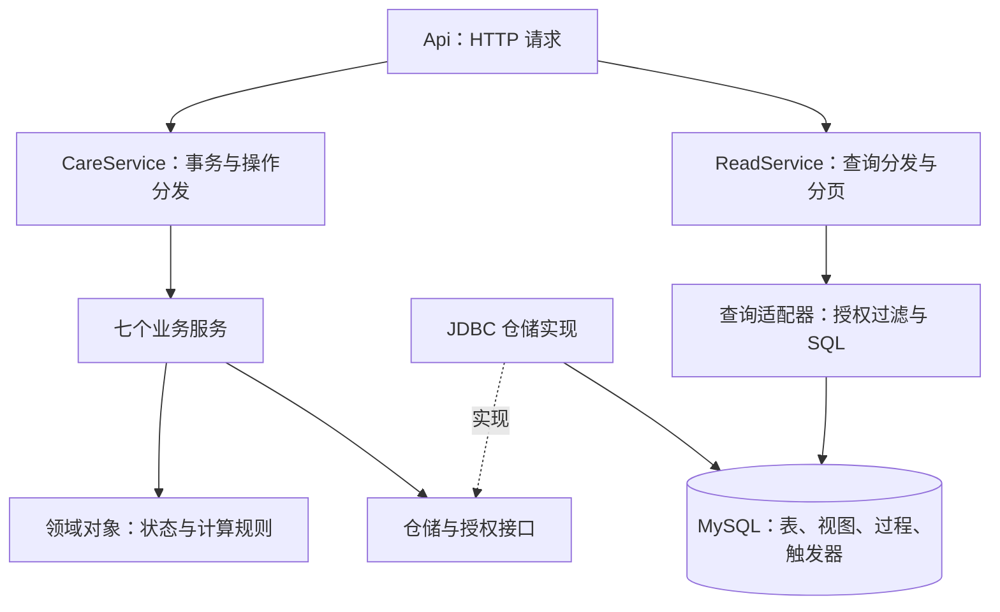

# Java 架构与开发约定

本项目采用 DDD 风格的分层单体。一个 Spring Boot 进程连接一个 MySQL 数据库，仍使用 Spring JDBC / JdbcTemplate 手写 SQL。DDD 是组织代码和业务规则的方法，不是数据库访问框架，也不替代课程要求的关系设计、视图、存储过程、触发器和数据库测试。

## 四层分别做什么

以下路径均相对于 `src/main/java/edu/bjfu/eldercare/`。

| 目录 | 负责的事情 | 不应放入的内容 |
| --- | --- | --- |
| `interfaces/web` | 接收 HTTP 请求，识别登录身份，返回结果和错误 | SQL、具体业务办理步骤 |
| `application` | 组织一次操作：校验权限、读取记录、调用业务规则、保存结果 | JDBC 实现、拼接业务 SQL |
| `domain` | 订单、投诉、计划、补贴、应急的状态规则，价格和围栏计算，以及仓储契约 | Spring 注解、数据库连接、HTTP 对象 |
| `infrastructure` | 实现 JDBC 仓储、查询、权限数据访问、加密、定时任务和种子初始化 | 向业务服务反向暴露具体数据库实现 |



虚线表示实现关系：业务服务通过接口调用仓储，Spring 在启动时注入 JDBC 实现。领域代码不需要知道连接地址、JdbcTemplate 或 HTTP 请求。

## 按业务查找代码

| 模块 | 应用服务 | 主要内容 |
| --- | --- | --- |
| 档案与照护 | `application/service/ElderService.java` | 老人、家属、评估、计划、服务包和项目 |
| 订单履约 | `application/service/OrderService.java` | 预约、推荐、派单、接单、签到、签退和确认 |
| 护工管理 | `application/service/WorkforceService.java` | 招聘、培训、资质、服务区域、排班和工时复核 |
| 服务反馈 | `application/service/FeedbackService.java` | 评价及投诉受理、回复、结案 |
| 健康监测 | `application/service/MonitoringService.java` | 设备、模拟采样、应急确认、响应、到场和关闭 |
| 补贴 | `application/service/SubsidyService.java` | 政策、申报、证明、分级审核、拨付和重报 |
| 监管 | `application/service/GovernanceService.java` | 抽查、整改、机构考核和公示 |

对应的 SQL 写入实现在 `infrastructure/persistence/Jdbc*Repository.java`；列表和详情查询放在 `infrastructure/query/*Queries.java`。这七个代码模块是对课程五条业务线的实现划分，不是新增七条教师要求。

`CareService` 负责统一的事务与操作分发；模块通过 `ActionModule` 注册操作。重复名称会阻止启动，避免新处理逻辑静默遮蔽旧逻辑。`ReadService` 同样检查重复查询和详情名称。兼容接口包括 `order.reject` 和 `order.release` 等兼容别名。

## 用“护工接单”理解调用过程

1. `interfaces/web/Api` 接收 `order.accept`，调用 `Auth` 识别账号。
2. `application/CareService.execute` 开启事务，设置审计身份，找到订单模块的处理方法。
3. `OrderService.acceptOrder` 检查角色，通过 `RecordAccess` 校验订单访问范围并读取加锁的记录。
4. `domain/order/ServiceOrder.requireAcceptable` 检查是否处于待接单阶段。
5. 服务通过 `OrderRepository` 调用资格检查并更新派单及订单。`JdbcOrderRepository` 使用 `Store` 执行参数化 SQL 和 `assert_worker_order` 过程。
6. 操作全部成功才提交。中间一步失败，由外层事务一起回滚。

订单推荐仅提供候选人。真正派单仍由 MySQL 过程在锁内检查资格、服务冲突和班次容量。Java 中的状态检查不能代替这一层并发保护。

## 事务和权限的边界

写操作的统一事务入口是公开方法 `CareService.execute`。模块的私有方法沿用该事务，不需要在每个方法上重复写注解。新增写操作须经过这个入口；不要把 `@Transactional` 放在内部自调用的私有方法上，然后误以为它开启了事务。

登录失败计数使用 `Auth` 中的独立事务，确保登录被拒绝时失败次数仍能保存。定时任务有自己的事务入口。过程内部不提前提交，避免破坏调用方的整体回滚。

应用层依赖 `Scope` 的授权操作；`JdbcScope` 查询账号与业务记录实现这些检查。查询使用的 SQL 过滤片段由基础设施中的 `QueryScope` 单独提供。家属关联、机构归属和多社区范围必须同时覆盖列表、详情和写操作，不能只在界面隐藏按钮。

## 领域模型与查询投影

订单、投诉、照护计划、补贴申报和应急事件使用明确的状态类型；服务价格和围栏计算可以独立测试。数据库继续承担跨行约束、并发保护和历史记录保护。

请求和查询投影采用 `Map<String, Object>`，与表单和 SQL 视图对应；部分旧输入保留字符串日期，由数据库按原有约定校验。业务模型按流程设置，领域状态对象处理规则，查询投影提供展示数据。流程复杂时可以增加专用命令和结果类型，数据库表与领域聚合不要求逐一对应。

## 修改代码时的约定

- 新功能先确定所属业务模块，再增加应用方法、领域规则或仓储操作。业务服务之间不互相调用，跨模块的步骤由应用入口组织。
- SQL 放进 JDBC 仓储或查询适配器，输入值用参数绑定。仓储方法写明业务含义和参数，不使用 `updateX2` 等编号名称，也不把任意 SQL 字符串作为业务接口。
- 只依赖需要的接口，使用构造器注入。领域对象不得依赖 Spring、JDBC 或接口层。
- 新增状态转换时同时检查允许和拒绝的情况；涉及容量、互斥、金额或多表写入时补真实 MySQL 回滚与并发测试。
- 修改路由时检查 `src/test/resources/api-contract.json`。旧接口删除需要明确说明并同步前端；不能为了让测试通过直接删除契约项。
- Java 使用四空格缩进，不把整个方法挤在一行，条件和循环使用大括号。构建中的 Spotless 检查统一格式。

```sh
mvn spotless:apply
mvn spotless:check
```

## 验证方式

`src/test/java/edu/bjfu/eldercare/domain/DomainRulesTest.java` 验证纯业务规则；`ArchitectureTest` 检查依赖方向；`application/RoutingTest` 检查重复注册、未知操作和分页拒绝；原有三组 MySQL 集成测试继续检查权限、触发器、回滚、并发与历史保护。`RouteContractIntegrationTest` 在 Spring 启动后核对 71 个操作、49 个列表和 15 类详情。

本机可用以下命令选择单独测试库。脚本会删除并重建该库，运行前确认没有其他任务使用它；数据库名仅允许 `eldercare_test` 或 `eldercare_<名称>_test`。

```sh
TEST_DATABASE=eldercare_refactor_test python3 scripts/test.py
```

浏览器测试默认使用 18081；可通过 `TEST_PORT` 选择 18081—18089 内的另一个测试端口。必须先启动连接相应独立测试库、关闭定时任务的应用，再执行脚本。不得将测试端口指向展示库。

```sh
TEST_PORT=18082 TEST_DATABASE=eldercare_refactor_test node scripts/verify_browser.cjs
```

测试结果以 `evidence/test-summary.json` 和 `evidence/completion-browser.json` 为准。运行包包含与发布源码对应的 JAR、SQL、报告和 PPTX；包内 SHA256SUMS.json 记录文件校验值。
