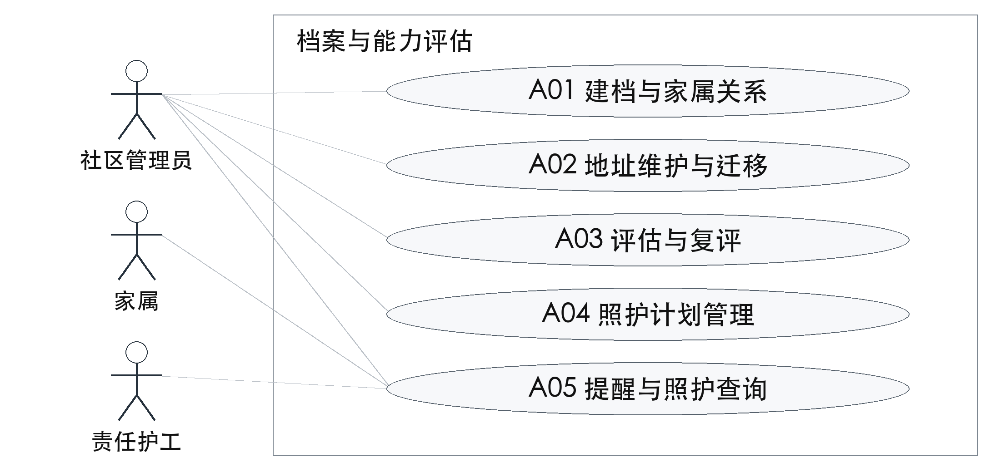
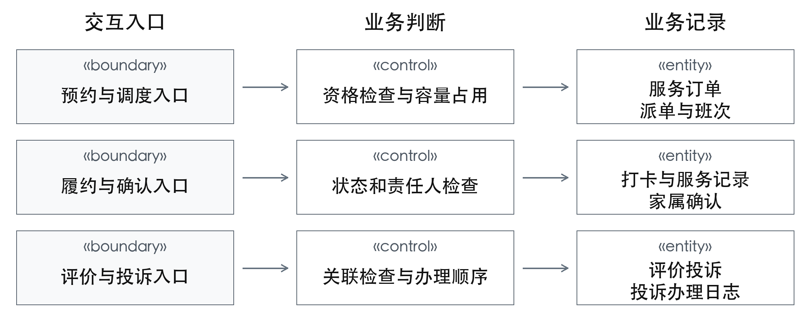
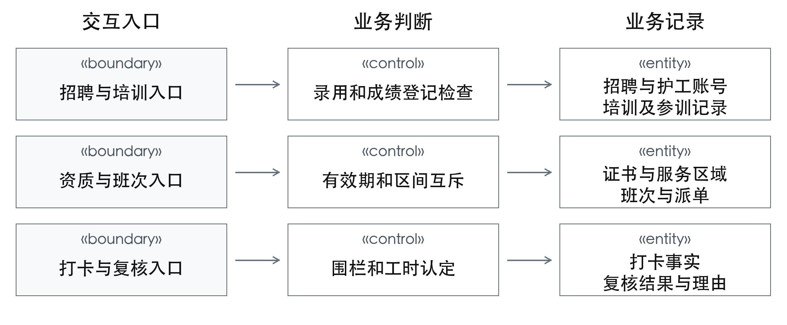
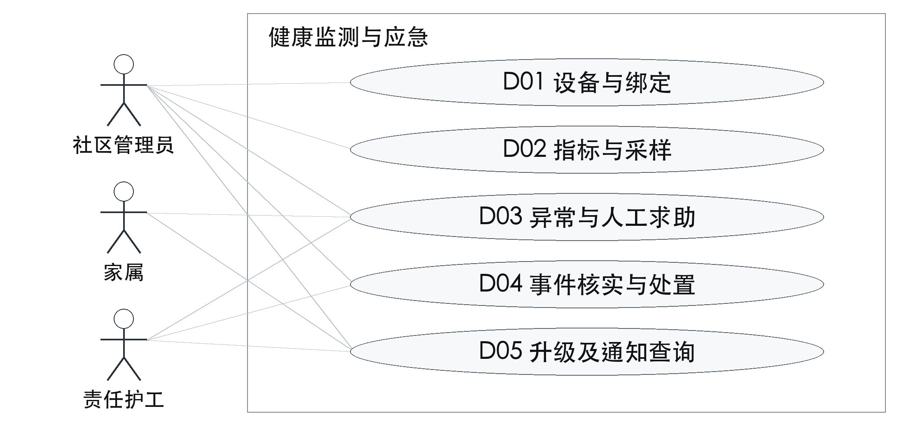
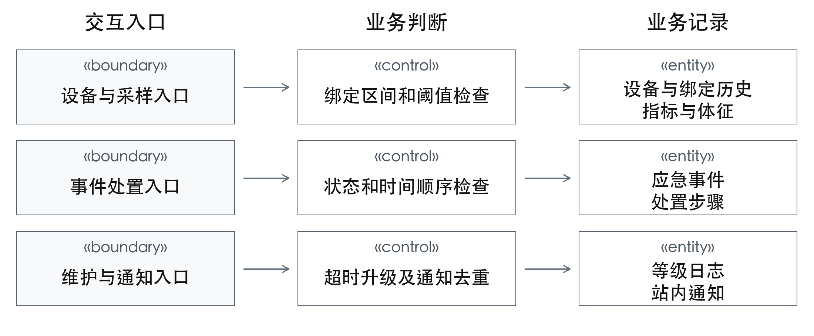
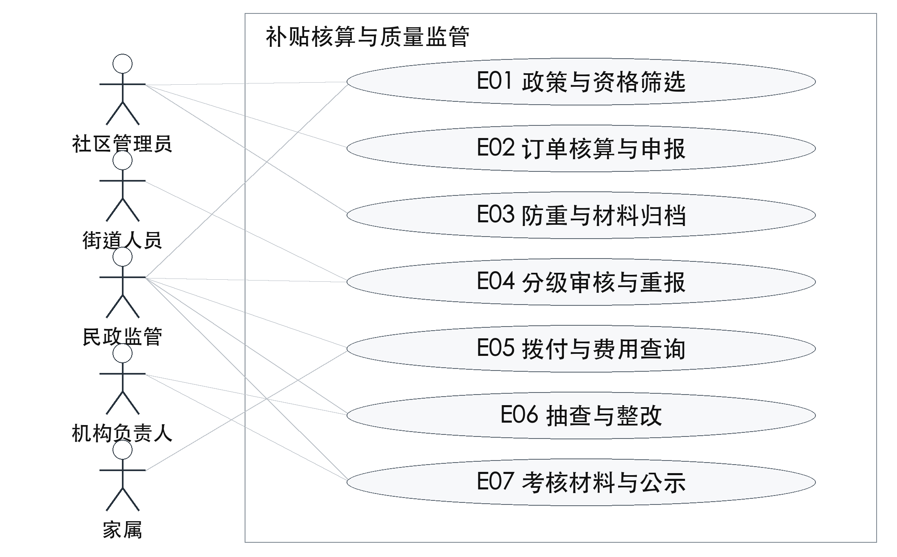
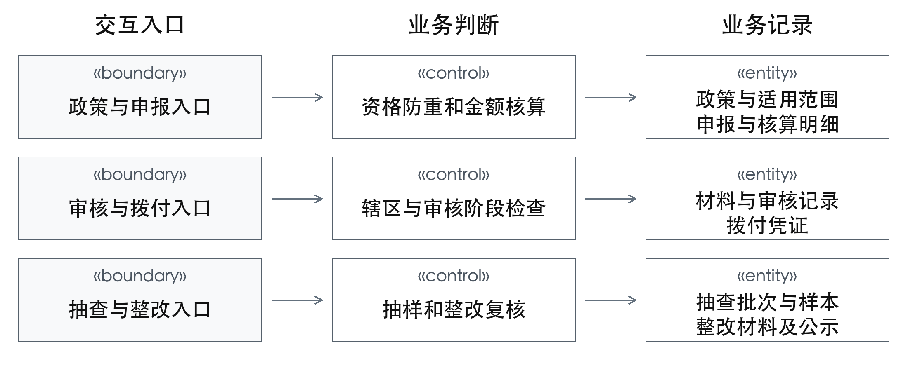

# 左邻右舍社区居家养老服务平台详细需求分析

数据库系统课程设计　2026 年 11 月 16 日

左邻右舍面向社区居家养老服务，管理老人建档、能力评估、照护计划、预约派单、上门服务、健康监测、补贴申报和质量监管。本项目要解决的主要问题是：服务资格过期后仍然派单、护工任务冲突、服务事实缺少确认、补贴重复申报，以及异常事件和整改事项无人跟进。

本文说明各角色需要完成什么工作，业务办理应满足哪些条件，系统需要保存哪些数据，以及怎样判断需求是否满足。需求按五条业务线组织；每项用例均说明前提、办理步骤、异常处理和结果。技术约定描述当前项目方案，完整字段定义和数据库结构分别见数据字典与设计文档。

## 1 需求依据与适用范围

### 1.1 需求来源

| 编号 | 依据 | 本文使用范围 |
| --- | --- | --- |
| S1 | 社区居家养老智慧服务平台课程设计2026年任务书 | 第 2 节业务、角色与关键规则；第 3—4 节数据库设计、测试、安全和提交要求 |
| S2 | 教师任务书讲解稿 | 对唯一建档、有效期、改派留痕、服务确认、设备历史、补贴防重和视图用途的解释 |
| S3 | 数据库系统课程设计报告模板2026 小组 | 第二章用例、鲁棒分析、数据项和非功能需求；第五、六章查询与数据库高级编程要求 |
| S4 | 数据库系统课程设计评分标准2026版 | 需求分析能否支撑结构设计，DAO 与 SQL 是否完整，安全、风险和运维是否结合业务 |
| S5 | 当前项目源码、建库 SQL 和验证记录 | 已确定的角色、状态、操作边界、计费口径和实施约定 |

任务书给出业务约束，教师讲解帮助解释约束的含义。例如，老人搬家应沿用原档案，订单可以多次派单，设备解绑不能删除原老人的体征记录。本文将这些要求写成可检查的办理规则，不把示例中的数字当作统一的现实政策或医疗标准。

### 1.2 课程要求与项目约定

课程明确要求覆盖五条业务线，完成需求分析、概念结构、逻辑结构、物理结构、实施测试、安全运维和答辩材料。每张表至少 20 条测试数据；至少 5 条查询连接 3 个及以上关系；每条业务线至少 3 个实用视图，以及至少 1 个存储过程或触发器。[S1 第 3—4 节]

小组报告模板进一步要求每条业务至少 3 个 SQL 查询、每个查询至少 2 种实现，并为每条业务给出至少 1 个过程和 1 个触发器。项目按这些材料要求组织 15 组双实现查询。视图应解决不同业务问题，不能仅修改时间范围凑数量。[S3 第五、六章；S2 00:27:30]

本项目确定使用 Java 17、Spring JDBC 和 MySQL，采用 DDD 风格的分层单体。Spring Boot 负责应用启动和 Web 支持，JDBC 负责数据库访问。任务书允许按语言选择 JDBC、数据库驱动或 ORM，并未指定 Spring Boot 或 DDD；本项目的 JDBC 方案是已经确定的实现约束。[S1 第 3.3 节；S5]

### 1.3 系统边界

系统提供网页办理、角色查询、数据库约束、站内通知和课程演示数据。老人及家属共用 FAMILY 角色，通过有效家属关系识别可访问的老人。街道和民政监管使用不同角色，以表达两级审核职责。

设备数据通过模拟器或批量上传产生；定位使用虚构平面坐标；拨付保存模拟凭证；通知保存为站内记录。真实设备协议、地图定位、短信、银行支付和电子签章不属于当前接入范围。证明材料以文本内容及摘要归档，当前没有通用文件上传、文件存储或电子签名验证服务。

系统不负责诊断疾病、自动判定真实护理等级或制定现实补贴政策。评估人员登记量表、得分和等级，政策参数由有权限的人员录入，系统据此执行资格和金额检查。

## 2 业务目标与使用人员

### 2.1 业务目标

老人档案应能连续记录其评估、计划和服务情况，迁移社区后仍可追溯原服务事实。每笔订单应能找到预约来源、历次派单、打卡和确认记录。护工是否可接单，应由资质、培训、区域、班次、在岗状态和整改情况共同决定。

补贴申报应能逐项说明补哪一笔订单、依据哪项政策、认定多少工时以及由谁审核。健康异常应形成有负责人、有时限、有处置结果的事件记录。监管人员应能在授权范围内查看统计、抽查真实性，并跟进整改结果。

### 2.2 角色与数据范围

| 角色 | 主要办理事项 | 数据范围与限制 |
| --- | --- | --- |
| 社区管理员 ADMIN | 建档、评估、计划、代下单、派单、投诉受理、设备、事件、补贴申报 | 所属社区；不能因知道记录编号就操作其他社区数据 |
| 老人及家属 FAMILY | 查看照护安排、预约、确认服务、评价投诉、求助、查看补贴及自付 | 有效 guardian 关系关联的老人；无权访问其他家庭 |
| 护工 CAREGIVER | 接单、签到签退、填写服务记录、查看本人排班与工时、参与应急处置 | 本人任务及责任范围；不能代其他护工接单和打卡 |
| 机构负责人 MANAGER | 招聘、培训、资质、服务区域、排班、工时复核、机构投诉与整改 | 本机构人员及关联业务；公共未派单订单不因曾服务该老人而自动归机构 |
| 街道人员 STREET | 补贴初审、辖区查询、覆盖率和预警统计 | account_scope 授权社区；不能执行民政终审或拨付 |
| 民政监管 REGULATOR | 政策维护、补贴终审、拨付登记、抽查、整改复核、机构考核、公示 | account_scope 授权社区；监管权限不等于任意改写原始服务事实 |

权限必须同时检查操作种类和记录归属。列表、详情、统计和写入接口使用一致的数据范围；页面隐藏按钮只改善使用体验，不能代替服务端鉴权。停用账号不能登录，已经建立的会话也应在后续请求时重新核验账号状态。

### 2.3 典型使用过程

社区管理员为周惠琴建档，登记能力评估并安排照护计划。家属预约送餐，系统推荐符合要求的护工，管理员派单。护工接单后签到、服务并签退，家属确认服务内容。社区依据有效工时和政策提交补贴，街道初审、民政终审后登记拨付。监管可抽查该订单，发现问题后要求机构整改。健康监测与求助流程可随时发生，不必等待服务或补贴结束。

## 3 总体业务流程与共同规则

业务主线为建档、评估、计划、下单、派单、服务、确认、补贴和监管。招聘培训为派单提供合格人员；健康监测产生独立应急事件；评价、投诉和抽查提供后续质量反馈。

下列三种事实分别保存：护工已经结束服务、家属已经确认、有效工时已经认定。服务签退不自动等于订单完成，订单完成也不自动等于可以申领补贴。补贴还要检查项目、政策、人员资格、工时和防重条件。

| 共同规则 | 业务要求 |
| --- | --- |
| 身份与归属 | 同一身份只建一份老人档案；当前归属和发生时的历史归属分别表达 |
| 时间区间 | 区间按开始时刻包含、结束时刻不包含理解；首尾相接不视为重叠；服务结束可恰好等于计划或班次截止 |
| 状态流转 | 必须从允许的前置状态办理，不能通过直接提交任意状态跳过业务步骤 |
| 多表一致 | 派单、改派、录用、申报、审核、换绑等操作必须完整成功或完整回滚 |
| 历史保存 | 改派、复评、解绑、审核、投诉回复和整改复核保留过程记录，不能用覆盖或删除代替历史 |
| 模拟边界 | 人物、体征、政策和凭证为课程数据；演示账号、数据库连接和密钥分别管理 |

以下 A—E 编号用于需求追踪，不是页面按钮或数据库主键。图中的用例表示角色需要完成的业务，鲁棒分析进一步区分交互入口、业务判断和保存的事实。

## 4 老人档案与能力评估需求

依据为任务书第 2.1.1、2.2.1—2.2.2 节，以及教师讲解 00:09:59—00:16:32。

### A01 建档与维护家属关系

**前提与输入。** 社区管理员已登录，提供老人姓名、身份标识、出生日期、地址、坐标、标签及家属账号、关系和联系方式。家属必须是系统中的有效 FAMILY 账号。

**办理与结果。** 校验身份唯一性和地址范围，建立档案并关联家属。一个老人可以有多个家属，一个家属也可关联多位老人；独居、失能、低保分别作为标签保存，不在同一文字字段内混写。

**异常与验收。** 重复身份、非家属账号、缺少必要信息或坐标超出社区范围时拒绝办理。身份证敏感原文和联系方式不能直接显示在普通列表中。解除家属关系后，该账号不能继续访问相应老人。

### A02 维护地址与跨社区迁移

管理员可在本社区范围内调整住址。迁移时沿用老人编号和身份标识，变更所属社区、住址及坐标，并保留变更记录。系统应拒绝重复建档式迁移。

本项目规定，迁移前处理未完成订单并解除当前设备绑定；原计划需按迁移后的服务安排重新处理。已有订单的服务社区、地址和价格，以及历史体征的绑定归属，不随迁移改写。停用档案也不能造成服务和资金历史丢失。

### A03 登记首次评估与复评

管理员选择老人，登记量表名称、得分、能力等级和有效期。得分限定在 0—100，等级为自理、部分失能或重度失能；截止时间必须晚于评估时间。每次复评形成新记录，已有评估不得直接覆盖。

后续计划使用最新已生效评估。当前复评生效时，旧评估对应的生效计划暂停。复评登记本身不以未完成订单清空为前提；后续预约、派单和接单仍须重新检查计划与评估资格。等级与分数是评估结果，系统不把课程样例的分数分组视为真实临床判级算法。

### A04 制定与调整照护计划

计划引用具体评估、能力等级匹配的服务包和责任护工，保存开始、结束时间，并用计划明细记录项目和每周频次。计划区间应处于评估有效期内，同一老人同一时段最多有一份生效计划。

调整计划应保留原版本；暂停、恢复和终止须检查当前状态与未完成订单。恢复时重新检查最新评估、时间范围和计划冲突。已终止或到期的计划不直接当作新计划使用。

### A05 复评提醒与照护查询

系统查询最新评估将在 30 天内到期的在册老人，向所属社区管理员生成去重提醒。评估过期后暂停计划，计划自身到期则标记到期；预约、派单和接单还应即时检查资格。

家属可查看关联老人的评估、照护项目、频次和责任护工。查询旧评估或旧计划时应明确状态，不能把历史安排展示为当前生效安排。定时任务关闭时，不应声称提醒和到期处理仍在后台运行。

档案和评估页面负责采集信息；档案维护、评估登记和计划校验负责决定能否办理；老人、家属关系、评估、服务包和计划明细保存结果。家属读取的是授权后的查询结果，不直接访问完整敏感字段。

## 5 服务订单与反馈需求

依据为任务书第 2.1.2、2.2.1—2.2.4 节，以及教师讲解 00:16:32—00:20:54。投诉处理来自角色职责，不能仅以评分功能代替。

### B01 维护项目与预约下单

服务项目保存名称、分类、计价单位、指导价、标准时长和可补贴标志。家属可为关联老人预约；社区可代录电话预约和社区预约，渠道分别保存为 FAMILY、PHONE、COMMUNITY。

下单时检查档案有效、项目属于生效计划、评估覆盖预约时段、地址处于社区服务范围。订单保存当时的金额、地址、坐标及服务社区。按次收取项目价格；按小时按项目价格与标准时长折算。项目后续调价不能改写旧订单金额。

### B02 推荐护工与正式派单

推荐应综合在岗状态、账号有效性、服务区域、项目证书、培训通过记录、班次时段、剩余容量、服务冲突和未完成整改。证书须同时覆盖当前资格检查时间及预约服务时段。

管理员选定班次后，正式派单在事务内重新检查条件，再占用名额、保存派单并改变订单状态。推荐结果只是候选列表，不能保证几分钟后仍有名额。两个请求争抢最后一个名额时，只允许一个成功。

### B03 改派与退回调度

改派必须填写原因，结束原有效派单并释放其占用名额，再建立新派单。订单与派单是一对多关系，同一订单同时只保留一条有效待接或已接派单。

护工可以在允许阶段退单，订单回到待调度状态。已开始服务的订单不能任意改派。新班次资格不符或容量不足时，整次改派回滚，原派单及原名额必须保持一致，不能留下无人承接的中间状态。

### B04 接单与上门服务

只有当前派单护工可以接单；接单时再次核验服务资格。签到要求订单已接单，并根据服务端计算的位置与时段保存打卡结果。签退要求已经签到，填写服务记录并记录结束位置和时间。

缺少签到不能直接签退，不能代他人打卡，也不能重复结束同一派单。签退完成后保存服务事实并进入待家属确认，工时另行核验。服务记录应描述已做事项及交接情况，而不是仅保存“完成”二字。

### B05 家属确认与订单取消

有效关联家属在核对服务记录后填写确认说明，系统保存确认人和时间，订单才进入已完成。没有服务记录或家属确认的订单不能用于补贴结算。本项目采用服务记录加家属账号确认作为完成证据，没有真实电子签章接入。

待派单、已派单、已接单订单可在规定权限内取消，并释放有效派单的名额；服务中、待确认和已完成订单不能直接取消。重复确认、重复取消应被拒绝，不能再次影响容量或结算。

### B06 服务评价与投诉办理

家属对已完成订单可提交 1—5 分评价及文字内容。投诉可针对关联订单提出，不以订单已经完成为前提；评价与投诉通过类型区分，不能把评价记录当作尚未受理的投诉。

投诉依次经过提交、社区受理、机构或社区回复、家属或社区结案。转交机构时应验证机构确实承接过该订单；未由机构承接的事项可由社区处理。转交机构后的投诉由该机构回复，未经回复不能直接结案。每一步保存人员、时间和意见。

### B07 超时调度与履约查询

待派单超过 15 分钟，或当前派单等待接单超过 15 分钟的订单进入超时调度查询。该入口按时间条件动态筛选，不额外复制一张订单。管理员可人工指派或改派；机构只能查看符合本机构范围的相关订单。

订单详情应显示历次派单、退单或改派原因、打卡、服务记录及确认。待家属确认查询帮助家属完成确认，改派历史查询帮助管理员解释服务安排变化。

预约和调度入口连接订单资格与容量判断；履约入口连接状态判断、打卡和确认；反馈入口连接投诉分派与回复判断。订单、派单、班次、打卡、服务记录和投诉日志分别保存各环节事实，不用一个状态字段代替全部证据。

## 6 护工与排班需求

依据为任务书第 2.1.3、2.2.3—2.2.4 节，以及教师讲解 00:21:27—00:23:34。招聘和岗前培训属于机构负责人的明确职责。

### C01 招聘登记与录用

机构负责人登记候选人、联系方式及申请信息，记录录用或拒绝决定、审核人、时间和意见。录用时同时创建护工账号、护工档案和默认服务区域，任一环节失败不得出现半录用记录。

同一申请不能重复录用；账号名称冲突应拒绝办理。未录用申请保留原因，历史应聘资料不因本次拒绝而删除。招聘用于形成机构人员档案，不扩展为完整人力资源或薪资系统。

### C02 培训与项目资质

机构维护培训名称、起止时间、参训护工和结果。报名记录初始为待登记，培训结束后记录 0—100 分成绩；项目采用 60 分及以上通过的演示规则。已确定的培训结果保留为历史事实。

项目证书分别记录项目、证书编号、类型、等级、开始和截止时间。通过培训不等于拥有所有项目资质；证书有效也不代替岗前培训。机构负责人可补录本机构证书类型；类型与等级分别保存，缺少原始类型的历史记录标为“未登记”，不能凭等级推断。缺证、过期、尚未生效或未通过培训的护工不能承接相应服务。

### C03 在岗状态与服务区域

护工状态分在岗、请假、离职。机构负责人维护本机构人员状态和可服务社区，系统在推荐、派单、接单时读取当前资格。离职或账号停用不能继续承接新任务，已有服务与工时记录必须保留。

服务区域用多对多关系表达，一名护工可按服务范围配置服务多个社区；这不意味着其机构负责人获得所有社区全部订单的访问权。状态或区域调整不能绕过已有任务的资格检查。

### C04 排班与容量控制

班次保存护工、开始和结束时间、容量、已占用数量与开放状态。同一护工开放班次不得重叠，容量为正数，已占用数量不得小于零或超过容量。即使两个班次均有名额，护工的实际服务时段也不能冲突。

已经产生派单的班次，其护工和时间范围不能任意改写。调整或关闭班次须检查当前任务。容量占用、取消释放和改派释放应与派单状态一起处理，不能只在页面上扣减显示数字。

### C05 工时核验与月度汇总

系统结合签到、签退、两次围栏结果和预约时段认定工时。本项目约定自动通过须满足：签到不早于预约前 30 分钟、签退不晚于预约后 30 分钟、时长不少于预约时长的 80%，且签到和签退均在围栏内。

异常工时进入待复核，由本机构负责人填写通过或否决理由；无正时长不能核定有效工时。有效工时按签到月份汇总，保存单位为分钟。服务评分和抽查评分分别统计，不混成没有说明的综合分。

人员管理入口负责招聘和培训记录，资格判断连接证书与服务区域；班次管理负责时段互斥和容量；工时复核负责认定结果。培训、证书、班次和打卡的含义不同，不能用“护工可用”一个标志替代全部条件。

## 7 健康监测与应急响应需求

依据为任务书第 2.1.4、2.2.3、2.2.5 节，以及教师讲解 00:24:18—00:27:30。

### D01 设备登记与绑定

社区管理员登记设备序列号、类型、安装位置和所属社区。正常设备可绑定本社区有效老人，记录绑定时间；同一设备同一时段只能关联一位老人。

解绑结束当前绑定区间，历史体征仍引用原绑定记录。换绑应在同一事务完成，不能产生重叠区间；已经解绑的历史不能再次改成当前绑定。设备停用前先解绑，离线设备保留档案但不继续自动采样。

### D02 指标配置与模拟采样

指标记录名称、下限、上限和响应时限，上限必须高于下限。管理员可批量上传采样，每批 1—500 条；每条包含绑定编号、指标编号、采样键、采集时间和数值，不能使用未来采集时间或不属于该绑定区间的时间。

绑定编号与采样键共同防重，重复上传不得重复生成体征和事件。单批任一条不合法，整批回滚。逐台开启的定时模拟只对有效绑定且正常工作的设备运行，间隔范围为 30—3600 秒。

### D03 异常判断与人工求助

采样值小于下限或大于上限时标记异常，恰好等于阈值视为范围内。异常采样建立待核实事件，并保留采样依据。家属求助和主动上报则记录来源、说明和一级至三级的事件等级。

管理员、家属、护工上报时仍须满足老人访问范围。当前自动模拟器主要生成范围内样本，异常路径可通过批量上传或业务示例演示。站内通知与真实短信、电话通知分别理解，不能把保存通知记录当成已经联系到本人。

### D04 核实与处置事件

设备异常先核实为需要处置或误报。误报须写明原因，保存为终态。需处置的事件由授权人员响应，保存响应人和时间，再记录到场与处置结果。

关闭事件前必须有响应、到场和结果，到场不得早于响应，关闭不得早于到场。已结案或误报记录不能重新改写事实。处置操作应由承担该事件的人员在其权限范围内完成。

### D05 超时升级与通知

未响应的待核实、待响应事件超过截止时间后升级，最高三级；升级需追加等级日志，重复扫描不能重复插入同一级升级记录。首次响应截止时间单独保留，用于计算是否按时响应，不能被后续升级覆盖。

通知范围包括有效家属、责任护工和本社区管理员，二级及以上增加本社区监管人员。跨社区监管查询授权不自动等于通知订阅。日常启动的后台任务每轮完成后间隔 30 秒检查；本地演示服务启用后台任务；独立浏览器测试服务关闭任务，自动处理另有定时任务验证。

采样入口连接绑定时间和指标判断，再保存体征与异常事件；处置入口连接状态、责任人和时间顺序检查；维护入口检查未响应事件并追加日志和通知。体征、事件与通知条数不能混作同一种统计数量。

## 8 补贴核算与质量监管需求

依据为任务书第 2.1.5、2.2.1、2.2.4—2.2.5 节，以及教师讲解 00:28:03—00:32:49。

### E01 政策维护与资格筛选

监管人员维护政策，社区管理员据此筛选申报资格。政策保存名称、服务项目、适用能力等级、补贴标准、生效区间、结算周期、最低年龄及可选标签要求。适用辖区通过社区范围表达，可覆盖多个社区；任务书中的区县政策范围由其覆盖社区落实到数据检查。

月度、季度、年度分别使用年月份、年季度和年份作为周期表示。政策金额、年龄和标签是录入规则，不是系统自行推导的真实政府政策。项目可补贴、政策有效和个人符合条件必须分别检查。

### E02 选择服务订单并提交申报

管理员选择老人、政策、周期和订单集合。系统逐笔校验：老人和项目一致、订单已完成、有家属确认、工时有效、服务时间属于申报周期与政策有效期、服务时的能力等级及年龄标签符合条件、服务社区在政策范围内。

按次补贴取政策单次标准与订单金额的较小值；按小时补贴先将有效分钟换算小时，再乘标准并保留两位小数，结果不超过订单金额。申报总额等于明细之和，明细保留核算工时和标准快照。任一订单不合格，整次申报回滚。

### E03 防重复与证明材料

同一老人、同一项目的申报区间不得重叠，不以周期字符串不同为由重复申报。例如，已经申报某季度后，不能再次对该季度内同一项目按月申报。同一服务订单只能进入一条补贴明细，不允许换个政策名称重复使用。

证明材料保存名称、提交人、时间、文本和内容摘要。摘要用于核对材料内容，不能被表述为第三方公证或电子签章。草稿只表示准备中的申报，不能直接拨付。

### E04 分级审核与驳回重报

街道初审通过后，民政监管方可终审；任一级驳回应记录审核阶段、决定、人员、理由和时间。未初审不能直接终审，其他辖区人员不能办理。已通过审核不能通过重复点击再生成相同阶段的有效决定。

驳回后在原申请补充说明和材料，再重新提交并走审核流程，保留原订单明细和审核历史。重报不创建一份绕过防重检查的新申请，也不通过删除旧明细释放已申报订单。

### E05 拨付与家属费用查询

终审通过后，监管人员登记唯一拨付凭证号、金额和时间。拨付金额须等于核定金额，同一申请只能登记一次拨付；已拨付申请、明细和凭证不得任意改写。

家属查看关联订单金额、已经拨付的补贴以及按该口径计算的自付部分。尚未拨付的审核中金额不能标成已到账。当前拨付是凭证登记，没有银行转账或实际收款确认接口。

### E06 按比例抽查与整改复核

监管人员在授权辖区选择服务期间、订单或护工类型及抽查比例。系统确定符合条件的总体，按比例形成样本，保存总体数、样本数、抽样种子与明细，便于解释“从哪些对象中抽到了谁”。

抽查方式为电话回访或上门核查，记录得分、问题和整改要求。低于项目设定分数或明确要求整改时，进入整改流程并限制相关护工接单。机构提交措施和证据，监管通过则结案，退回则追加下一次材料，原提交与审核保留。未整改完成不能直接解除接单限制。

### E07 机构考核与结果公示

机构负责人按周期提交服务情况和证明材料，监管记录采纳或退回意见，历次提交分别保留。公示关联已完成的抽查结论，保存发布人、时间、标题和正文；撤回须记录时间和原因。

公示仅允许关联已关闭且有评分的抽查。标题和正文由系统根据抽查方式、评分及完成状态生成，不包含姓名、住址、健康档案或投诉原文；同一抽查不能重复发布有效公示。公开入口只呈现这些公示字段。机构材料与公示不能用删除旧记录代替修订过程。

申报入口连接政策资格、防重与金额核算，审核入口连接阶段和辖区判断，抽查入口连接样本、整改及公示。申报明细是追溯资金的依据，审核记录是决定过程，拨付记录是资金状态凭据，三者分别保存。

## 9 数据项与实体关系需求

### 9.1 核心数据项分解

粗略类型用于从业务抽取信息。标识和数量用数字型，名称、说明、状态和编号文本用字符型，业务时间用日期时间型，开关与判定结果用布尔型。金额采用定点小数；加密内容以密文保存，其业务含义不因存储形式变化。

| 业务对象 | 主要数据项及粗略类型 | 约束与含义 |
| --- | --- | --- |
| 老人档案 | 数字：档案编号、社区、坐标；字符：姓名、身份标识、地址、状态、标签；日期：出生日期 | 身份唯一；同一人迁移沿用档案；身份原文受保护 |
| 家属关系 | 数字：老人、家属账号；字符：关系、联系方式；布尔：是否有效 | 老人与家属多对多；停用关联影响后续访问 |
| 能力评估 | 数字：编号、老人、得分、评估员；字符：量表、等级；日期时间：评估、截止 | 评估追加保存；得分合法；有效期可检查 |
| 照护计划 | 数字：编号、评估、服务包、责任护工；字符：状态；日期时间：起止；数字：项目频次 | 项目与频次拆成明细；同一时段最多一份生效计划 |
| 服务项目 | 数字：编号、指导价、标准分钟；字符：名称、类别、单位；布尔：可补贴 | 按次或按小时计价；时长为正，价格非负 |
| 服务订单 | 数字：编号、老人、项目、社区、金额、坐标；字符：地址、渠道、状态；日期时间：创建和预约起止 | 保留发生时的服务地址、社区和金额 |
| 派单及服务记录 | 数字：订单、班次、确认人；字符：状态、原因、服务说明、确认说明；日期时间：派单、接单、确认 | 一单多次派单；旧派单和已确认内容受保护 |
| 护工与资质 | 数字：护工、账号、机构、项目；字符：姓名、在岗状态、证书号、类型、等级；日期时间：资质起止 | 一人可有多项资质、多个服务社区 |
| 排班 | 数字：班次、护工、容量、已占用量；字符：状态；日期时间：起止 | 时段互斥，容量受约束；使用中的班次不任意改写 |
| 工时 | 数字：派单、坐标、有效分钟、复核人；布尔：两次围栏结果；日期时间：签到签退；字符：状态、复核理由 | 打卡事实与有效工时分别保存 |
| 设备与绑定 | 数字：设备、老人、社区、模拟指标、采样间隔；字符：序列号、类型、位置、状态；日期时间：绑定、解绑 | 同一设备区间互斥；解绑保留原归属 |
| 体征与指标 | 数字：绑定、阈值、指标值、响应秒数；字符：指标名、采样键、来源；日期时间：采集；布尔：异常 | 按绑定与采样键防重；不同指标分别判定 |
| 应急事件 | 数字：老人、体征、等级、响应人；字符：来源、状态、结果；日期时间：发生、首次截止、当前截止、响应、到场、结案 | 事件、等级日志、操作步骤、通知分别记录 |
| 政策 | 数字：项目、标准、最低年龄；字符：名称、对象等级、标签、周期；日期时间：起止；关联：适用社区 | 资格、时效、范围和金额标准均可追溯 |
| 申报与拨付 | 数字：老人、项目、订单、政策、金额、工时、审核人；字符：周期、状态、决定、凭证号；日期时间：周期区间、审核、拨付 | 明细防重；金额可复算；两级审核与拨付分开 |
| 质量抽查 | 数字：订单或护工、批次、评分、比例、总体及样本数；字符：方式、问题、整改、状态、种子；日期时间：抽查区间、创建 | 抽查对象二选一；整改和复核追加留痕 |

### 9.2 支撑数据与拆分理由

账号、社区、机构和账号授权范围支撑角色隔离。老人标签、家属关系、服务包明细、计划明细、护工区域和政策范围表达多值关系，不能全部压进逗号分隔字符串。招聘、培训和培训记录分别表达申请、课程和参训结果。

评价投诉、投诉日志、抽查批次、整改提交、机构报告、公示和证明材料用于保存过程。审计日志记录关键对象变更，不能代替业务自身的审核记录。当前关系设计共 47 张基础表；全部字段的名称、类型、精度、默认值、主外键及约束见《数据字典与关系模式》。

### 9.3 关键联系及基数

| 联系 | 基数与附加约束 |
| --- | --- |
| 老人与评估 | 一对多；当前资格使用最新已生效评估 |
| 评估与计划 | 一对多；计划通过评估确定所属老人 |
| 计划与项目 | 多对多，通过计划明细记录频次 |
| 老人与家属 | 多对多，通过有效家属关系限定访问 |
| 老人与订单 | 一对多；订单保留服务发生时的社区和地址 |
| 订单与派单 | 一对多；同时最多一个有效待接或已接派单 |
| 护工与班次 | 一对多；开放区间不重叠，实际任务也不冲突 |
| 班次与派单 | 一对多；有效占用受到容量限制 |
| 派单与打卡及服务记录 | 分别至多一份；签退、确认和认定结果各自保存 |
| 设备与老人 | 通过绑定历史关联；同一设备的绑定区间不能重叠 |
| 绑定与体征 | 一对多；体征不能跟随设备换绑改归属 |
| 申报与订单 | 一份申报可含多笔订单，每笔订单至多一条补贴明细 |
| 申报与审核及拨付 | 审核一对多，拨付至多一份；不能覆盖驳回历史 |

### 9.4 字典与枚举

核心枚举包括能力等级、计划和订单状态、预约渠道、计价单位、在岗状态、派单状态、工时认定、设备状态、事件状态、结算周期、审核决定、培训结果和整改结论。字符串显示名称可以调整，存储值及状态含义必须保持稳定。

课程演示数据覆盖基础表中 30 个枚举字段的 100 个取值，也包含空可选标签、有效与失效关联、正常与异常采样等情况。枚举覆盖用于验证显示和办理分支，不代表每个过滤视图都必须展示全部状态，也不代表单靠样例即可证明全部业务正确。

## 10 状态管理与跨业务一致性

### 10.1 主要状态转换

| 对象 | 正常流转 | 分支与终态限制 |
| --- | --- | --- |
| 照护计划 | ACTIVE 生效、PAUSED 暂停，可按条件恢复 | ENDED 终止、EXPIRED 到期后制定新计划 |
| 订单 | PENDING → ASSIGNED → ACCEPTED → SERVING → CONFIRM → COMPLETED | 前三个阶段可取消；服务中及以后禁止任意取消或改派 |
| 派单 | WAITING → ACCEPTED → FINISHED | 允许阶段可转 REASSIGNED 或 REJECTED；结束的旧记录不能覆盖 |
| 工时 | PENDING → VALID 或 REVIEW；REVIEW → VALID 或 INVALID | 待复核不计有效分钟；最终认定记录受保护 |
| 投诉 | SUBMITTED → ASSIGNED → REPLIED → CLOSED | 无回复不能结案；普通评价以 REVIEW 类型区分 |
| 事件 | UNCONFIRMED → OPEN → RESPONDED → CLOSED | 待核实或待响应可判误报 FALSE_ALARM；关闭须有到场和结果 |
| 补贴 | DRAFT → SUBMITTED → STREET_APPROVED → APPROVED → PAID | 审核可转 REJECTED，补件后回 SUBMITTED；已拨付不可改写 |
| 抽查整改 | PENDING → OPEN → REVIEW → CLOSED | 复核退回后回 OPEN；无需整改的检查可直接形成结论 |
| 招聘与培训 | APPLIED → HIRED 或 REJECTED；PENDING → PASS 或 FAIL | 不重复录用；已登记结果作为历史保留 |
| 机构材料 | SUBMITTED → ACCEPTED 或 RETURNED | 再次提交形成新材料，已审核内容不覆盖 |

### 10.2 事务边界

派单应将资格检查、容量占用、派单记录和订单状态放在同一事务。改派还包括结束旧派单和释放原容量。录用包括申请结论、账号、护工及服务区域。设备换绑包括结束旧关系和建立新关系。批量体征上传包括各条采样及其告警副作用。

补贴申报包括全部订单资格检查、申报主记录、核算明细和总额；审核包括阶段变化和审核记录；拨付包括金额检查、凭证及状态。失败时不得保留部分明细、释放一半的名额或没有主记录的证据。

用户写操作由应用层统一事务入口组织，SQL 位于 JDBC 仓储和查询适配器。数据库外键、唯一约束、检查约束、过程和触发器同时参与校验。普通触发器不会因为时间经过而自行运行，到期处理必须有定时或人工调用入口。

### 10.3 项目采用的参数

| 参数 | 当前项目约定 | 需求说明 |
| --- | --- | --- |
| 复评提醒 | 截止前 30 天 | 提前提醒窗口，不能代替到期拦截 |
| 未接单超时 | 15 分钟 | 待派单从创建时间计算，待接单从当前派单时间计算 |
| 工时自动核验 | 提前或延后边界各 30 分钟，时长至少达到预约的 80% | 任一条件不满足转人工复核 |
| 培训通过 | 60 分及以上 | 课程演示分数，不是行业统一标准 |
| 后台扫描 | 每轮完成后间隔 30 秒 | 依赖任务启用；无毫秒级实时响应承诺 |
| 模拟设备间隔 | 30—3600 秒 | 每台设备独立开关及指标配置 |
| 坐标与围栏 | 虚构米制平面，社区配置范围与围栏半径 | 服务端计算距离，不能只信任前端布尔结果 |

## 11 查询统计与视图需求

### 11.1 五条业务的查询用途

| 业务线 | 三类查询需求 | 使用目的 |
| --- | --- | --- |
| 档案评估 | 近期复评名单；当前生效计划及责任护工；家属照护安排 | 提醒复评，确认当前服务资格和责任关系 |
| 订单履约 | 超时调度；待家属确认；改派历史 | 处理待办，补齐确认，追溯调度变化 |
| 护工排班 | 即将到期资质；班次剩余容量；异常工时 | 续证、排班和工时复核 |
| 健康应急 | 当前设备绑定；异常体征；未结案事件与剩余时限 | 管理设备、核实异常、跟进响应 |
| 补贴监管 | 可申报服务；审核拨付进度；未完成整改 | 准备申报、追踪资金及控制接单资格 |

视图提供查询口径，服务端继续添加角色和行范围过滤。不能因为通过视图查询就认为所有角色天然只能看自己的数据。15 组双实现 SQL 应分别说明业务问题、连接关系、筛选条件、聚合口径和执行计划，不能只比较运行时间。

### 11.2 统计口径

护工服务评价均分只统计已完成服务的 REVIEW 记录，COMPLAINT 不进入评价均分。无评价时显示空值，不按零分处理；抽查得分单独展示。

月度有效工时按签到月份汇总已认定有效的分钟。多次派单、投诉或审核连接时，先按对象聚合或去重，避免一笔服务被累计多次。

辖区服务覆盖率以当前社区在册老人数为分母，以这些在册老人中当月有已完成服务的去重人数为分子。该口径按老人当前归属计算，与订单发生时的服务社区口径不同；迁移后的展示应按此解释。

预警及时响应率按事件发生月份统计，排除误报，并以保存了首次响应截止的事件为分母；响应时间不晚于首次截止的事件计入分子。未响应事件保留在分母，后续升级不重置原始考核时限。

当月已拨付补贴按拨付月份和申报记录保存的社区汇总。分母为零时显示“—”，不写成 100%。服务评价分和抽查分独立计算，当前页面不额外声称具备未定义的综合评分、投诉率或预测分析指标。

## 12 非功能需求与技术边界

### 12.1 登录安全与权限

密码使用加盐哈希保存；登录失败累计触发临时锁定，会话有有效期。SQL 使用参数绑定，不能把用户输入拼接成查询条件。每次业务调用同时检查登录身份、角色和记录范围，防止修改网址或记录编号后越权。

数据库连接口令、字段加密密钥及本机配置不进入共享仓库。演示密码只是本地课程访问配置，不能作为正式部署的密码策略。应用数据库账号与数据库管理员账号分开使用。

登录用户可修改自己的密码，填写当前密码、新密码和确认密码。忘记密码由工作人员核实身份后重置：社区管理员负责本社区家属，机构负责人负责本机构护工，管理人员通过离线维护工具恢复。密码重置后旧会话失效，首次登录必须修改临时密码，完成前不能访问业务数据或提交业务操作。重置记录保留经办人与原因，不记录密码。

### 12.2 敏感信息与历史保护

身份标识以带密钥摘要用于查重，敏感原文及联系方式加密保存；普通查询按角色限制字段和解密范围。日志和公开材料不应保存登录密码、令牌、加密密钥或完整个人身份信息。

已确认服务、评估、体征、审核、拨付及审计等历史受限制性更新和删除规则保护。数据库超级管理员仍能管理结构和授权，因此本项目的历史保护不能表述为能够抵御最高数据库权限的绝对不可篡改。

### 12.3 完整性与并发

主外键、非空、唯一、检查约束保障字段和引用有效。计划互斥、设备区间、班次容量、实际时间冲突、申报防重和状态前置条件需要跨行或跨表判断。对可能竞争的对象加锁并条件更新，不能依赖“用户不会同时点击”。

应验证最后名额竞争、并发建计划、并发申报、重复采样、重复确认与重复拨付。异常输入不得产生部分业务记录，拒绝理由应让用户知道需要补齐什么条件。

### 12.4 性能与可用性

列表分页，限制查询页大小和批量上传数量；针对社区、状态、时段和外键连接建立必要索引，并使用执行计划检查复杂查询。小规模课程数据的耗时不能作为城市级并发性能证明。

系统以本机 Java 服务和真实 MySQL 演示，当前监听回环地址。Windows 源码运行需要 Java 17 和 MySQL，Docker 不是必需组件。具体生产并发容量、可用性百分比和响应时间承诺未作为已验证指标。

### 12.5 备份恢复与维护

课程采用每日一次全量备份、每 15 分钟归档 binlog、保留 7 天的方案，目标 RPO 为 15 分钟、RTO 为 30 分钟。备份文件与字段密钥分开保管，恢复到独立库后再核对。对已有库执行数据导入或结构升级前，先备份、在副本演练，再核对数据；恢复演练使用独立库，不清空展示库来证明可恢复。

恢复核对应包含行数、关键关联和逐行内容，不能只以恢复命令成功结束为准。运行时保留排查日志，配置与业务数据分开。数据清理和历史保留期需要明确业务授权，不能默认删除已完成订单或健康记录。

### 12.6 使用与维护体验

页面使用中文状态和清晰的错误提示，常用列表优先显示姓名、状态及业务时间，表格支持分页和横向查看。姓名、金额、编号和时间应区分，不能要求用户仅凭数据库编号理解全部业务。

代码按接口、应用、领域和基础设施分层。业务服务通过接口组织流程，领域规则不依赖数据库和 Web 框架；SQL 在基础设施层维护。新增业务规则时同步接口、数据库约束、需求说明和相应测试。

## 13 验收场景与测试数据需求

### 13.1 主要验收场景

| 编号 | 操作或异常输入 | 应得到的结果 |
| --- | --- | --- |
| T01 | 同一身份再次建档 | 拒绝重复；保留一份老人档案 |
| T02 | 老人跨社区迁移 | 档案编号不变；历史订单与绑定归属不被重写 |
| T03 | 新增已生效复评 | 保存新评估；旧评估对应生效计划暂停 |
| T04 | 同老人同时创建重叠生效计划 | 至多一份成功；相邻不重叠区间按规则允许 |
| T05 | 评估过期后预约或接单 | 即使尚未扫描到期任务，也拒绝不合格办理 |
| T06 | 服务地址不在社区范围 | 下单失败，不产生非法订单 |
| T07 | 无证、未培训、请假或有未完成整改的护工接单 | 资格检查拒绝，说明不满足条件 |
| T08 | 两个请求争抢最后一个班次名额 | 仅一个成功；容量与派单一致 |
| T09 | 改派目标班次不合格 | 整体回滚，原派单和占用名额仍有效 |
| T10 | 另一护工替当前护工接单或打卡 | 拒绝越权 |
| T11 | 服务记录齐全但没有家属确认 | 保持待确认，不能用于补贴结算 |
| T12 | 家属确认后再次确认 | 不重复完成，不重复生成结算依据 |
| T13 | 围栏或时段异常，或零分钟工时 | 异常转复核；零分钟不能认定有效 |
| T14 | 未回复投诉直接结案 | 拒绝；合法流程追加完整办理日志 |
| T15 | 同一设备建立重叠绑定 | 拒绝；换绑后旧体征仍属于原老人 |
| T16 | 批量采样中一条时间非法或采样键重复 | 整批回滚，不留下部分采样和告警 |
| T17 | 样本恰在阈值、略高或略低 | 边界按规则判断；异常创建待核实事件 |
| T18 | 未响应事件超过时限并重复扫描 | 按等级升级，日志去重，首次时限保留 |
| T19 | 没有到场或处置结果就关闭事件 | 拒绝；有效流程保存完整时间和结果 |
| T20 | 一份申报中混入未完成或工时无效订单 | 全部回滚，不保留部分申报明细 |
| T21 | 同老人同项目按月和按季度重复覆盖 | 拒绝重叠区间；同订单不能换政策再次申报 |
| T22 | 未街道通过就终审或拨付 | 拒绝越级；合法审核逐步留痕 |
| T23 | 驳回后补件重新提交 | 沿用申请和订单明细，保留历次审核 |
| T24 | 重复拨付或金额与核定值不符 | 拒绝；一份申请只有一份有效拨付 |
| T25 | 抽查要求整改后继续接单 | 按规则限制，复核通过后才解除对应限制 |
| T26 | 家属访问未关联老人，或管理员访问其他社区 | 列表不泄漏，详情和写入均拒绝 |
| T27 | 监管查看授权及未授权社区 | 只覆盖 account_scope 允许的范围 |
| T28 | 独立库恢复备份和增量 | 结构、行数、关键业务及数据内容核对一致 |

### 13.2 测试数据组织

基础种子保证每张基础表不少于 20 条记录；业务示例覆盖正常流程、待办状态、异常待复核和已归档历史。数据应能串起老人、评估、计划、订单、派单、工时、确认、申报与审核，不能用彼此无关的行只凑数量。

非法记录通过测试尝试写入并验证被拒绝，不作为正式演示数据长期保存。多枚举覆盖用于检查不同业务分支；对并发和边界还需独立用例，不能用一张状态分布表代替测试。

### 13.3 当前验证证据的范围

2026 年 11 月 16 日的本地记录为 188 项自动化测试通过，其中 150 项 MySQL 业务测试、1 项路由契约集成测试、37 项独立测试。React 页面检查覆盖六种角色、七个账号的 144 次页面访问和 86 个表单入口（73 种业务操作），见 `evidence/natural-names/pages.json`。跨角色办理和提交记录见 `evidence/react`，业务表单提交 61 次、密码弹窗操作 2 次。实际 30 秒调度连续运行两个周期，验证提醒去重、评估到期与复评计划暂停、应急升级和模拟采样。记录见 `evidence/test-summary.json`、`evidence/completion-browser.json` 和 `evidence/scheduled-jobs.json`。

演示数据导入验证还包含原有行保留、重复导入不变、后段冲突整批回滚及后续接单、确认、工时复核。这些证据对应当次环境和代码，不代表 Windows 实机、真实设备、真实支付或生产规模性能已经验收。

## 14 需求追踪与课程材料

| 业务需求 | 主要数据 | 当前实现位置 | 核对重点 |
| --- | --- | --- | --- |
| A01—A05 档案与评估 | 老人、家属、评估、服务包、计划及明细 | ElderService 与 JDBC 档案仓储；计划校验与到期过程 | 唯一性、有效期、复评、计划互斥与迁移 |
| B01—B07 订单与反馈 | 订单、派单、服务记录、投诉与日志 | OrderService、FeedbackService 及对应 JDBC 仓储 | 容量事务、改派历史、确认、受理回复结案 |
| C01—C05 护工与排班 | 招聘、护工、资质、培训、区域、班次、工时 | WorkforceService；班次与工时数据库规则 | 录用原子性、培训资格、时间冲突、复核 |
| D01—D05 健康与应急 | 设备、绑定、指标、体征、事件、日志、通知 | MonitoringService、Jobs、Simulator 及数据库规则 | 绑定历史、采样防重、升级和处置顺序 |
| E01—E07 补贴与监管 | 政策、申报明细、证据、审核、拨付、抽查整改、公示 | SubsidyService、GovernanceService 及对应数据库规则 | 防重、工时核算、分级审核、整改限制 |

用例说明与鲁棒分析服务于数据项提取；数据项再支持局部和全局概念模型、关系模式及物理字段设计。SQL、视图、过程与触发器应能反向指向具体业务规则。评分标准强调分析能够支撑设计，而不是只展示表数或代码行数。[S4 小组报告评分标准]

当前数据库为 47 张基础表、15 个业务视图、2 个内部视图、10 个存储过程和 74 个触发器。过程与触发器数量是实施结果，不是本文额外增加的教师最低要求。分层和 JDBC 设计详见《Java 架构与开发约定》，字段定义详见《数据字典与关系模式》，课程条款对应详见《需求追踪与模板差异》。

## 15 待确认与验收边界

待确认：教师对设备上传、定位、通知、拨付及账号确认采用模拟实现的最终验收口径。当前接入范围见第 1.3 节，不把模拟结果写成真实外部服务已接通。

待验证：目标 Windows 电脑上的安装、启动和完整角色演示。现有本机 MySQL 与浏览器检查不能代替 Windows 实机结果。

待验证：课程备份方案的长期定时运行与故障情况下的恢复时限。当前证据为本机独立库的受控恢复演练。

待确认：如项目需要对接真实服务，能力评估标准、补贴政策、应急时限、资质判定和隐私保留期应采用经业务方确认的规则；本文课程参数不作为现实执行依据。

真实成员分工、个人贡献和协作记录另按实际参与情况整理，本需求文档不预设个人贡献。该部分按项目当前安排暂不展开。

## 16 参考材料

S1　《社区居家养老智慧服务平台课程设计2026年任务书》，第 1—9 页。其中五条业务位于第 1—4 页，角色位于第 5 页，设计实施与提交要求位于第 5—9 页。

S2　《数据库大课设——任务书解读》教师讲解稿，本地留存文本。重点位置：00:11:08 唯一身份与迁移；00:17:19—00:18:58 改派与确认；00:22:17—00:23:34 资质与工时；00:24:49 设备历史；00:27:30 视图用途；00:28:53—00:29:12 补贴防重；00:33:47 事务与并发；00:34:23 视图和过程或触发器要求。

S3　《数据库系统课程设计报告模板2026（小组）》，第二章、第五章、第六章。本文用例与鲁棒分析图、粗略数据类型和非功能需求对应第二章要求。

S4　《数据库系统课程设计评分标准2026版》，小组综合实践报告的问题分析、解决方案和项目管理条目。

S5　项目源码、`database/01_schema.sql`、`database/02_routines.sql`、`database/03_views.sql`、`src/test/resources/api-contract.json` 与 `evidence/demo-scenarios.json`。

配套阅读：[数据字典与关系模式](数据字典与关系模式.md)、[逻辑设计与范式分析](逻辑设计与范式分析.md)、[Java 架构与开发约定](Java架构与开发约定.md)、[演示数据说明](演示数据说明.md)。
