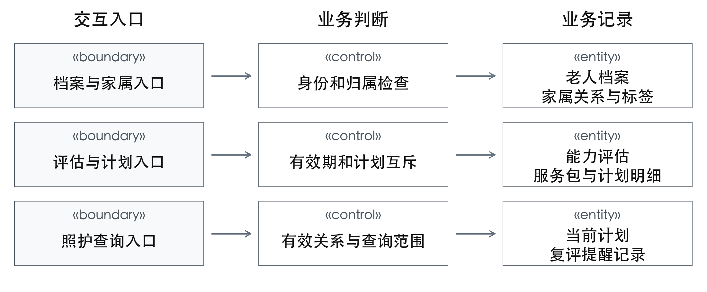
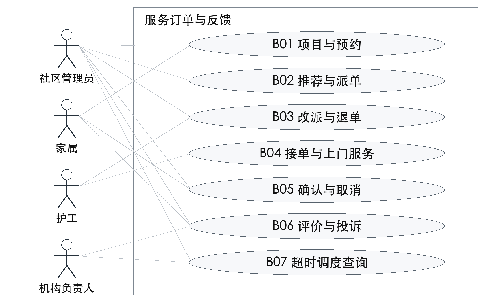
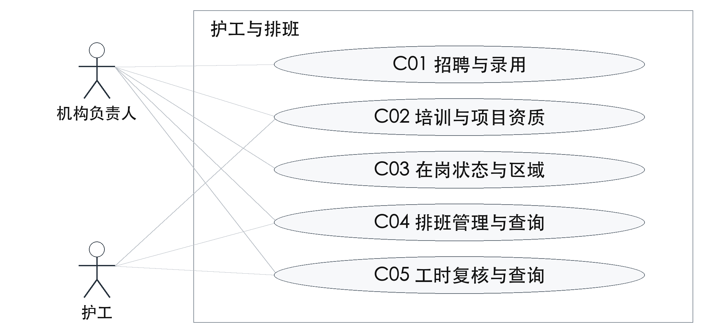

# 左邻右舍社区居家养老服务平台详细需求分析

数据库系统课程设计　2026 年秋季

以家属替周惠琴预约上门助餐为例，社区要先看她的评估是否有效、照护计划里有没有助餐，再找一位有资质、当班还有名额的护工。服务结束，家属需要知道谁来过、做了什么。社区申报补贴时，还得查得到这笔订单、确认记录和有效工时。

如果周惠琴在服务前搬了家，社区要核对新地址。如果护工临时请假，社区要重新派单。家属事后询问时，经办人应能从同一笔订单查到前后两次安排。

## 1 服务范围与使用人员

平台面向社区居家养老服务。社区负责建档、评估和调度，服务机构安排人员上门，街道和民政部门审核补贴、监督服务质量。设备告警和人工求助可以随时发生，有没有服务订单都可以上报。

| 使用人员 | 日常要办的事 | 可以查看的范围 |
| --- | --- | --- |
| 社区管理员 | 建档、组织评估、制定计划、代下单、派单、受理投诉、处理应急、汇总补贴 | 本社区老人和业务记录 |
| 老人及家属 | 查照护安排、预约服务、核对服务记录并确认，评价、投诉或求助，查补贴和自付金额 | 与账号有有效关联的老人。一个家庭照顾多位老人时，可按人分别查看 |
| 护工 | 查班次和名额、接单、签到签退、填服务记录，查累计工时，上报健康异常或居家环境隐患 | 自己的班次、派单、工时和承担照护责任的相关事件 |
| 服务机构负责人 | 招聘、培训、管证书、按月排班、处理未接单任务、核验工时、回复投诉、提交整改及考核材料 | 本机构的人员、班次、订单和整改记录 |
| 街道审核人员 | 核验订单和证明材料，办理补贴初审，查看辖区统计 | 获授权的社区及其申报记录 |
| 民政监管人员 | 维护政策、终审、登记拨付、抽查、复核整改、考核机构、发布公示 | 获授权辖区内的业务和汇总。原始打卡和服务记录由相应经办人负责 |

老人及家属共用家庭端。街道初审与民政终审由不同岗位办理。课程平台使用站内通知、模拟设备数据和平面坐标，拨付以登记凭证为准。对外公示只展示抽查结论。银行转账、短信送达和医疗诊断由平台外的机构或人员办理。

## 2 老人档案与能力评估

周惠琴第一次来社区登记时，即使家属尚未开通账号，管理员也可以先建档。以后复评、换住址或更换联系人，都沿用她的档案编号。见任务书第 2.1.1 节。

### A01 建档与联系家属

管理员登记姓名、身份证号、出生日期、住址和坐标。系统核对社区服务范围，统一身份证号的大小写和首尾空格后查重。独居、失能、低保等标签可以分别维护。需要家属代办时，再关联本社区有效的家属账号，登记关系和联系电话。一位老人可以关联多位家属，关系停用后，相应账号失去对该老人的访问权。

### A02 变更住址或迁移社区

在本社区搬家，只更新地址和坐标。迁往其他社区时，先处理未完成订单、解除原社区设备的绑定，再变更档案归属。原设备留在原社区。过去的订单保留下单时的服务社区、地址和金额。设备换绑后，旧采样仍能查到当时对应的老人。停用档案前同样要处理未完成订单。

### A03 登记首次评估与复评

管理员登记评估员、量表名称、评估日期、得分、等级和有效期。例如可登记日常生活活动能力量表（ADL）或简易智能状态量表。课程系统接受 0 至 100 的录入分值，能力等级由评估人员填写，分为自理、部分失能和重度失能。每次复评另存一条，保留前次结果。

### A04 制定和调整照护计划

按最新已生效的评估匹配服务包，选定责任护工，列明服务项目、每周频次和起止时间。同一老人同一时段最多有一份生效计划，计划须处于评估有效期内。调整项目或频次时保留旧版本。暂停、恢复、终止时检查未完成订单。恢复还要重新核对评估和时间冲突。

### A05 到期提醒与家属查询

最新一次评估进入到期前 30 天时，系统提醒所属社区安排复评。每次评估只提醒一次。评估过期后暂停相应计划，预约、派单和接单时也要检查资格。计划到了约定的结束时间，状态转为到期。新的评估生效后，原评估下仍在执行的计划暂停。家属可查看评估、当前计划、服务频次和责任护工。

图中把身份核对与计划校验分开。身份核对回答“是不是同一位老人”，计划校验回答“老人此时能接受哪些服务”。这些资料分别保存在老人档案、家属关系、能力评估和照护计划中。[数据字典](数据字典与关系模式.md#能力评估-assessment)

| 关键数据项 | 粗略类型 | 业务含义 |
| --- | --- | --- |
| 档案编号 | 数字型 | 同一老人在平台沿用的档案编号，跨社区迁移也保留 |
| 身份证号 | 字符型 | 用于唯一建档，敏感原文加密保存 |
| 家属关系、联系电话 | 字符型 | 记录谁可代办、怎样联系，电话按权限查看 |
| 评估得分、能力等级 | 数字型、字符型 | 分别保存量表得分和评估员给出的等级 |
| 评估日期、有效期截止 | 日期时间型 | 判断哪次评估生效，以及何时提醒复评 |
| 计划项目、每周频次 | 数字型 | 分别记录项目编号及每周安排次数 |
| 责任护工、计划起止时间 | 数字型、日期时间型 | 查明哪个时段由谁负责照护 |

## 3 预约、派单与服务确认

一笔订单可以经过多次派单。即使换了护工，家属也应能查到原来的安排、改派原因以及最后实际提供服务的人。见任务书第 2.1.2 节。

### B01 预约上门服务

家属先选老人和时间，再选该时段能预约的项目。从家庭端预约，订单渠道自动记为“家属下单”。社区可代录电话预约或社区下单。老人须在册，地址在所属社区范围内，评估和计划覆盖预约时段。订单留存当时的地址、服务社区和金额。按次项目收一次指导价。按小时项目用小时单价乘标准分钟数再除以 60，金额保留两位小数。例如每小时 40 元、标准时长 90 分钟，订单金额为 60 元。

### B02 推荐护工与派单

系统根据项目证书、培训、在岗状态、账号、服务区域、班次、名额、预约冲突和整改情况筛选人选。派单时证书须有效，且有效期须覆盖整个预约时段。管理员选定班次后再次核验条件。两单同时争最后一个名额时，只有一单能占用最后一个名额。

### B03 改派与退回调度

改派须填写原因，保留旧派单并释放原名额，再为新班次占用名额。新班次不合格时，原分配继续有效。护工可以在允许阶段拒接或退单，机构也可退回本机构的派单。护工已签到进入服务中后，同一笔订单不能再退回待派。

### B04 接单、上门和离场

当前派单的护工接单后到老人住处签到，离开时填写服务内容、交接事项并签退。系统记录两次时间和位置，服务端判断是否在围栏内。没有签到记录不能签退。签退后订单进入待确认，工时按第 4 节的条件单独认定。

### B05 家属确认与取消

家属核对实际提供服务的护工、服务时间和服务内容，再用关联账号确认。系统记录确认人、时间和说明。服务记录和家属确认齐备，订单才能完成。待派、已派或已接单的订单可按权限取消，同时释放已占用的名额。服务开始后不再受理取消。

### B06 评价与投诉

家属可对已完成的服务给出 1 至 5 分评价。投诉可在订单完成前提出。社区受理后自行处理，或转交确实承办过该单的机构。承办方答复，再由家属或社区结案。未派单的投诉由社区处理。经办人、时间和意见逐次保存。

### B07 超时未接与错过预约

待派超过 15 分钟，或派出后等候接单超过 15 分钟，且预约时段仍有效的订单进入超时调度池。整个预约时段已经过去的待派单另列为“待联系”。管理员联系家属后，可在原单改约并重新检查照护计划，也可办理取消。系统保留待联系记录，原时段不再推荐或派单。

预约留下订单，派单记录每次人员安排，服务记录写明谁上了门、做了什么。家属确认落在那次实际完成的服务上。三类记录串起来，才能说明“谁接了单、谁上了门、谁确认过”。[数据字典](数据字典与关系模式.md#服务订单-service_order)

| 关键数据项 | 粗略类型 | 业务含义 |
| --- | --- | --- |
| 项目名称、类别和计价单位 | 字符型 | 如助餐、助浴、陪诊、家政或康复护理，按次或小时计价 |
| 指导价、标准时长 | 数字型 | 作为下单时的计费依据，时长以分钟计 |
| 预约起止、地址与坐标 | 日期时间型、字符型、数字型 | 确定哪段时间到哪里服务 |
| 渠道、金额、订单状态 | 字符型、数字型、字符型 | 记录预约来源、约定金额及办理阶段 |
| 派单编号、班次、改派原因 | 数字型、数字型、字符型 | 区分同一订单历次安排并保留原因 |
| 服务内容、确认人、确认时间 | 字符型、数字型、日期时间型 | 供家属核对，也是补贴核算的依据 |

## 4 护工资质、排班与工时

机构负责人按月安排护工每天的班次，公布可接单时段和名额。排班回答“可以派谁”，打卡和工时认定回答“谁实际服务了多久”。见任务书第 2.1.3、2.2.3 和 2.2.4 节。

### C01 招聘与录用

机构登记申请人和联系方式，写明录用或拒绝意见。录用时一并建立账号、护工档案和默认服务区域。账号冲突等原因导致办理失败时，这几项一起撤销。拒绝录用的申请保留审核记录。

### C02 培训与证书

机构安排岗前培训、登记参训人员，课程结束后记录分数和结果。课程采用 60 分及以上通过的规则。项目证书另行登记证书号、类型、等级、适用服务和有效起止。证书类型按凭证填写，不能从等级推断。派单须同时满足培训和项目资质要求。

### C03 在岗状态与服务区域

机构维护护工在岗、请假、离职状态及可服务社区。一名护工可以服务多个社区。请假、离职、账号停用或不在服务区域时，不再承接相应新任务，既有服务记录和工时保留。

### C04 班次与可接单量

同一护工的开放班次不能重叠。每班记录容量、已占用数和剩余名额。即使班次还有容量，同一护工也不能同时为两个家庭上门。护工可查看自己的排班。已派单班次的人员和时段受保护，取消、退单或改派与名额释放一并办理。

### C05 工时认定与查询

自动认定有效工时有四个条件。签到、签退均在服务围栏内，签到不早于预约前 30 分钟，签退不晚于预约后 30 分钟，实际时长达到预约时长的 80%。异常记录交本机构负责人复核并说明理由。零分钟不能核定为有效。

护工可查自己累计及逐月的有效工时，机构和社区各查授权范围。按签到月份归集，一人一月一条汇总。列表按人员、状态或日期筛选时，合计覆盖筛选出的全部记录，翻页不改变总数。待核验和无效记录分别计数，有效分钟才计入工时。

证书说明护工能做哪类服务，班次说明什么时候有空，打卡与复核共同决定哪段时间可以结算。三者分别保存。[数据字典](数据字典与关系模式.md#项目资质-credential)

| 关键数据项 | 粗略类型 | 业务含义 |
| --- | --- | --- |
| 护工、所属机构 | 数字型 | 区分人员和负责维护档案的机构 |
| 证书编号、类型、等级 | 字符型 | 识别证书，区分职业类别和技能等级 |
| 证书起止、适用项目 | 日期时间型、数字型 | 判断本次服务是否在资质范围内 |
| 班次起止、名额和已占用数 | 日期时间型、数字型 | 用于公布可接单时段并防止超额派单 |
| 签到签退时间、位置 | 日期时间型、数字型 | 记录服务发生时间及两次位置坐标 |
| 围栏结果、有效分钟 | 布尔型、数字型 | 校验地点，保存最终可结算的时长 |
| 复核人、复核理由 | 数字型、字符型 | 说明异常工时由谁认定、为何认定 |

## 5 健康监测与应急处置

设备异常、家属呼叫以及护工在屋内发现的隐患，都需要有人接手。每次事件分别记录首次响应、到场和结案的时间。见任务书第 2.1.4、2.2.3 节。

### D01 设备登记与绑定

社区登记设备的序列号、类型、安装位置和状态。血压计、一键呼叫器等设备在同一时段只能绑定一位老人。换绑时结束原区间，再建立新绑定。旧体征仍归采集时的老人。设备退役前先解绑。

### D02 定时采样与上传

按指标设置上下限和响应时限。正常且已绑定的设备可开启定时模拟，采样间隔为 30 至 3600 秒。管理员也可批量上传，每批 1 至 500 条。每条采样须在对应绑定区间内，不能使用未来时间。同一绑定下的采样键唯一，一批中有一条不合格，整批都不入库。

### D03 发现异常与人工上报

采样值低于下限或高于上限时，系统标记异常并建立待核实事件，恰好等于边界值时属于范围内。家属可以主动呼叫。护工可上报老人健康异常，也可上报居家环境隐患。例如，老人主诉头晕时记录健康异常，发现卫生间扶手松动时记录环境隐患。人工上报记录所涉老人、来源、等级和现场说明。

### D04 核实、响应与到场

工作人员核实设备告警。误报须说明原因，需要处置的事件记录响应人和响应时间。人员到场后单独登记到场时间，处置结束后填写结果并结案。到场不能早于响应，关闭不能早于到场。通过这些时间可以区分“无人响应”“已响应、待到场”和“已到场、待结案”。

### D05 升级与通知

告警立即通知有效关联家属、责任护工和本社区值班人员。二级及以上再通知本社区监管人员。未响应且超过本级截止时间的事件自动升级，最高三级。设备告警的初始时限取自指标规则。人工上报按一、二、三级分别设置 300、180、60 秒。事件升到二级后有 180 秒响应时间，升到三级后有 60 秒。保留首次截止时间和每次升级日志。已经响应的事件继续跟进到场、结案，不再报成响应超时。

一条异常采样提供告警依据，一次应急事件可以有多条通知、升级和处置记录。统计响应情况时按事件计数。[数据字典](数据字典与关系模式.md#应急事件-emergency)

| 关键数据项 | 粗略类型 | 业务含义 |
| --- | --- | --- |
| 设备序列号、安装位置 | 字符型 | 识别设备并找到安装地点 |
| 绑定编号、绑定与解绑时间 | 数字型、日期时间型 | 确定采样发生时设备属于哪位老人 |
| 采样键、采集时间 | 字符型、日期时间型 | 识别一次采样，防止重复上传 |
| 指标类型、数值、异常标记 | 数字型（指标编号）、数字型、布尔型 | 按对应指标的上下限判定异常 |
| 事件来源、等级 | 字符型、数字型 | 区分设备告警、家属呼叫与主动上报 |
| 首次截止、本级截止、响应时间 | 日期时间型 | 分别用于及时率统计、升级判断和响应登记 |
| 到场时间、处置结果 | 日期时间型、字符型 | 保存现场到达时间及结案依据 |

## 6 补贴核算与服务质量监管

一笔补贴要能说清楚补给谁、对应哪次服务、为什么是这个金额。一次抽查也要查得到抽中谁、发现什么问题、由谁整改，以及谁作了复核决定。见任务书第 2.1.5、2.2.4 和 2.2.5 节。

### E01 政策与适用对象

北京市民政局等部门在 2019 年印发的办法中，分别考虑了经济困难、失能和高龄老人的照护需要。在本课程项目中，对象条件分为年龄、能力等级和可选标签。民政人员为每项课程政策登记适用地区、服务项目、有效期、结算周期和补贴标准。政策的地区范围按所辖社区登记。每笔补贴按平台登记的政策标准核算。[北京市政策原文，京民养老发〔2019〕160号](https://www.beijing.gov.cn/zhengce/zhengcefagui/201910/t20191028_454233.html)

### E02 按订单核算申报

社区选择老人、政策及月度、季度或年度结算周期，勾选符合条件的订单。每笔订单须已完成，有家属确认和有效工时，服务项目可补贴，服务社区在政策辖区内。服务开始时间须落在申报周期内，整个预约时段须在政策有效期内。

年龄按服务开始日计算，能力等级取服务开始时最近一次已生效且覆盖服务时段的评估。低保等标签按申报时档案中的登记值判断。例如，服务结束后、申报前补录了低保标签，这次申报就能读到该标签。按次项目取单次标准，按小时项目用每小时标准乘有效分钟数再除以 60。金额保留两位小数，两者均以订单金额为上限。各笔金额相加得到申报总额，任一笔不合格则整份不予提交。

### E03 防重复与材料归档

同一老人、同一项目的申报周期不能重叠，已经纳入季度申报的项目不能再对重叠月份重复申报。同一订单只能进入一条申报明细。每笔明细保留核算时采用的政策标准、有效分钟数和金额。证明材料保存名称、内容、摘要、提交人和时间。

### E04 两级审核与补件重报

街道先核验订单、有效工时、家属确认和证明材料，民政再终审。任何一级驳回都要写明理由和经办人。社区在原申报上补材料、重新提交，沿用原明细并保留上次审核意见。审核人员只能办理授权社区的申报。

### E05 拨付与家庭自付

终审通过后登记拨付凭证、时间和金额。拨付金额须等于核定金额，每份申报只拨一次。家属可查看关联老人的已完成订单金额、已拨付补贴及自付部分，审核中的金额不计入已拨补贴。

### E06 抽查、整改与复核

监管人员按辖区、期间和比例抽查订单或护工，保留抽查总体数、样本数和选中对象。电话回访或上门核查时登记方式、评分、发现的问题和整改要求。问题记录要能看出类别和事实，例如在“发现的问题”中写“服务迟到，约定 9 时，9 时 25 分到场”。其中“服务迟到”是问题标签，其余文字是现场说明。问题标签可以随说明一起登记。

抽查得分低于 60 分或被明确要求整改的事项，由机构提交措施与材料。未完成整改限制相关护工接单。每份待审材料只接受一次复核决定，材料结论、经办人和抽查主记录必须一致。退回后机构可另交一份材料，前次意见保留。

### E07 机构考核与公示

抽查得分可按实际服务护工和所属机构汇总，供机构考核使用。家属评价单独统计。机构按周期提交考核材料，监管人员记录采纳或退回意见。已结案且有评分的抽查可发布公示，公开抽查方式、评分和完成状态。撤回公示须留原因和时间，公开内容不含老人姓名、住址、病情或投诉原文。

审核人员从申报明细找到具体订单，再查相应工时和家属确认。抽查按订单时，可以据实际完成派单找到护工和机构。按护工抽查时，直接关联其档案。[数据字典](数据字典与关系模式.md#质量抽查-inspection)

| 关键数据项 | 粗略类型 | 业务含义 |
| --- | --- | --- |
| 适用社区、最低年龄、对象标签 | 数字型、数字型、字符型 | 约束政策适用的地区和人群 |
| 政策起止、结算周期 | 日期时间型、字符型 | 规定何时适用、按月季年哪种方式申报 |
| 核算订单、有效分钟、明细金额 | 数字型 | 将每笔补贴追溯到服务及工时 |
| 审核阶段、决定、经办人 | 字符型、字符型、数字型 | 区分两级审核，查明驳回理由及责任人 |
| 凭证编号、拨付金额 | 字符型、数字型 | 记录哪一笔核定补贴已经拨付 |
| 抽查方式、评分、问题标签与说明 | 字符型、数字型、字符型 | 保存回访或上门结果、问题类别及事实 |
| 整改要求、提交材料、复核结论 | 字符型 | 逐次保留机构答复及监管决定 |

## 7 业务查询与统计口径

家属要查某一次服务，社区要查今天该派哪些单，民政则要看整个辖区。这三种查询在入口、范围和统计单位上各有不同。每条业务线至少提供三个供经办人员查询的数据库视图，涉及时间经过的事项由后台作业定时检查。

| 业务线 | 三项常用查询 | 数据库要保证的动作 |
| --- | --- | --- |
| 档案与评估 | 即将复评的老人、当前计划与责任护工、家属可看的照护安排 | 创建或恢复计划前检查评估和时间冲突。后台暂停过期评估对应的计划 |
| 订单与派单 | 等候过久的派单、待家属确认的服务、历次改派 | 派单时检查资格并占用名额，订单完成时检查确认依据 |
| 护工与排班 | 即将到期的证书、班次可用名额、待复核的异常工时 | 排班时检查时段重叠，签退后根据两次打卡核定工时 |
| 健康与应急 | 设备当前绑定、异常体征、未结案事件 | 采样时核对绑定和阈值，未响应超时的事件逐级上报 |
| 补贴与监管 | 可申报的服务、审核拨付进度、未完成的整改 | 汇总申报金额、阻止重复申报，检查审核及拨付的先后顺序 |

常用的统计口径如下。各项统计先限定账号可查的老人、机构或社区，再进行汇总。

| 指标 | 计算方法 |
| --- | --- |
| 总有效工时与月工时 | 只加总已认定有效的分钟数。月工时按签到所在月归集，同一护工跨月分别列示 |
| 护工服务评价 | 对已完成服务的普通评价取平均。投诉、监管抽查分另行记录。没有评价时显示空值 |
| 机构与护工抽查分 | 按抽查对象或被抽订单的实际服务护工关联到机构、人员，对有评分的抽查取平均 |
| 社区服务覆盖率 | 分母是该社区当前在册老人。分子是其中本月有已完成服务的去重人数，月份取预约开始时间 |
| 应急及时响应率 | 按事件发生月份统计。分母为有首次截止时间的非误报事件，分子为首次截止前或恰好在截止时响应的事件。未响应事件留在分母 |
| 辖区汇总 | 多个社区先分别加总人数或事件数，再计算比例。分母为零时显示“—” |
| 补贴与自付 | 辖区按拨付月份、申报所属社区统计已拨金额。家庭按所选老人汇总已完成订单金额，扣除分摊到这些订单的已拨补贴 |

## 8 数据保护与运行约束

### 记录之间的关系

| 关联记录 | 数量关系与用途 |
| --- | --- |
| 老人、家属与评估 | 一位老人可关联多位家属，一位家属也可照顾多位老人。一次评估只属于一位老人 |
| 评估、计划与服务项目 | 一次评估可对应多份不重叠的生效计划。计划可含多个项目，每个项目的频次写在明细中 |
| 订单、派单与班次 | 一笔订单可有多次派单，同时至多一条有效。每次派单占用一个班次，护工从班次确定 |
| 派单、打卡与服务记录 | 每次派单至多有一份打卡和一份服务记录。家属确认关联到实际完成的那一次服务 |
| 设备、绑定与体征 | 一个设备可先后绑定不同老人。一次采样关联一条绑定记录，通过它确定当时的老人 |
| 申报、订单与拨付 | 一份申报可含多笔订单，同一订单至多纳入一次。审核可以有多次，拨付至多一笔 |
| 抽查与整改材料 | 每次抽查针对一笔订单或一名护工。机构可先后提交多份材料，每份保留自己的复核结果 |

### 账号与权限

账号由工作人员建立。用户修改自己的密码须核对原密码。家属忘记密码，由本社区管理员核实后重置。护工由本机构负责人办理。管理岗位使用离线恢复。重置后旧会话失效，下次登录须更换临时密码。审计记录保留经办人和原因。

登录密码使用加盐哈希保存。连续失败达到限制时临时锁定，会话到期、账号停用后停止访问。列表、统计、详情和写操作均须检查角色与记录归属。公开公示使用单独的只读入口。身份标识保存用于查重的带密钥摘要，敏感原文和联系电话加密保存。普通列表不展示完整敏感字段，密钥与备份分别保管。

### 历史、时间与并发

历史评估、派单、已认定工时、服务确认、整改意见、拨付凭证和应急升级都须留存。更换设备、迁移档案或重报补贴时，旧记录仍按原业务关系查询。区间按开始时刻计入、结束时刻不计入来判断重叠，两个首尾相接的班次可以分别安排。

同一订单的签到与退回、同一材料的两个复核决定，都按取得锁后的实际状态办理。涉及多张表的操作须一并生效或一并回滚。例如改派失败，原班次名额仍被占用。一份申报混入无效订单，不能只留下其中几笔。定时作业每轮结束后间隔 30 秒检查提醒、过期计划和应急升级。下单、派单和接单当场也要判断资格。

### 使用、持久化与恢复

日常办理面向桌面浏览器，课程演示程序须能在 Windows 电脑上本地运行。家属从已选老人开始预约，审核人员从申报直接查证明材料。有关联的表单先选老人、时间或政策，再给出可用项目、班次或订单。没有待办、查询失败和没有权限分别提示，提交出错时保留可继续填写的内容。

项目选用 Java 17、Spring JDBC 和 MySQL。数据库操作涵盖增删改查、分页和事务内的批量写入。查询参数绑定，历史记录按业务规则限制更新和删除。对按社区、状态、日期查询的常用路径设计索引，用执行计划核对多表查询。

课程备份方案为每日全量备份、每 15 分钟归档增量日志、保留 7 天。目标是最多损失 15 分钟数据（RPO），30 分钟内恢复服务（RTO）。演练应从全量备份所记日志位置恢复到独立库，核对行数、关键记录内容和业务查询结果。两个时限均作为演练目标。

## 9 验收场景

验收以办理结果和数据库记录为准。正常业务要能走完，错误操作要有明确提示。遇到同时办理同一业务的情况，还要复核订单、班次、材料、审核历史之间是否一致。

### 档案与照护

| 编号 | 操作或条件 | 预期结果 |
| --- | --- | --- |
| T01 | 为尚无家属账号的老人建档，再用相同身份证号建档 | 第一次可独立完成，第二次被拒。家属以后可另行关联 |
| T02 | 办理跨社区迁移 | 未完成订单或在绑设备阻止迁移。办妥后档案号沿用，原服务和体征仍可追溯 |
| T03 | 新复评已经生效 | 保留原评估，旧评估下的生效计划暂停，后续服务依据新评估 |
| T04 | 同时为一位老人建立两份重叠计划 | 至多一份成功，前一份结束时间恰等于后一份开始时间时可相接 |
| T05 | 评估过期后预约或接单 | 即使后台尚未扫描，也拒绝办理 |

### 派单、工时与投诉

| 编号 | 操作或条件 | 预期结果 |
| --- | --- | --- |
| T06 | 服务地址超出所属社区范围 | 拒绝下单，不生成订单 |
| T07 | 护工缺有效证书、未通过培训、请假或有待整改事项 | 不能承接该项服务，提示相应原因 |
| T08 | 两个请求竞争同一班次的最后一个名额 | 仅一笔派单成功，名额与有效派单一致 |
| T09 | 改派到不合格的班次 | 恢复原派单和原名额，不生成新的有效派单 |
| T10 | 另一名护工尝试替本单护工接单或打卡 | 拒绝办理，保留原服务人员 |
| T11 | 护工已签退，家属尚未确认 | 订单待确认，不能结算补贴 |
| T12 | 家属对同一服务重复确认 | 只保留一次有效确认 |
| T13 | 围栏异常、时长不足或服务为零分钟 | 异常工时进入复核，零分钟不能认定有效 |
| T14 | 投诉尚未回复即要求结案 | 拒绝结案，受理、回复和结案能依次追溯 |
| T15 | 护工已签到，另一人同时退回调度 | 后办理者按订单现状判断。签到生效时不能退单释放名额 |
| T16 | 订单已错过整个预约时段 | 列为待联系，原时段不能再派。有效改约回到可派队列，取消则保留取消记录 |
| T17 | 分页查看筛选后的工时，或同一人跨两月有服务 | 换页不改变总有效分钟，同一人的两个月份各有一条月记录 |

### 设备与应急

| 编号 | 操作或条件 | 预期结果 |
| --- | --- | --- |
| T18 | 同一设备尝试重叠绑定，再正常换绑 | 重叠被拒，正常换绑后旧采样仍属于原老人 |
| T19 | 一批体征中含非法时间或重复采样键 | 整批回滚，不留下部分体征或告警 |
| T20 | 样本恰在阈值、略高于上限或略低于下限 | 边界值判为范围内，超出范围产生待核实事件 |
| T21 | 未响应事件超过截止时间，后台重复扫描 | 按等级升级，同一级升级记录不重复，首次截止时间保留 |
| T22 | 在未登记到场或未填结果时结案 | 拒绝结案，响应、到场和关闭时间分别可查 |
| T23 | 事件按时响应，当时限过去时仍未到场 | 提示已响应、待到场，及时响应统计仍依据首次截止时间 |

### 补贴、授权与恢复

| 编号 | 操作或条件 | 预期结果 |
| --- | --- | --- |
| T24 | 申报中混入未完成订单或无有效工时的服务 | 整份回滚，不留部分申报明细 |
| T25 | 为同一老人、同一项目再申报重叠的月份或季度 | 拒绝重叠申报，同一订单不能换政策再次使用 |
| T26 | 跳过街道审核直接终审或拨付 | 拒绝办理。每一级审核分别记录经办人、意见和时间 |
| T27 | 申报被驳回后补交材料 | 沿用原申请和订单明细，保留历次决定 |
| T28 | 重复拨付或登记金额与核定金额不同 | 拒绝办理，同一申报只产生一次有效拨付 |
| T29 | 护工有未完成整改，或机构重交整改材料 | 受限事项完成前不能接单。重交材料保留前次提交和结论 |
| T30 | 家属访问未关联老人，或社区管理员访问其他社区的档案 | 列表不返回记录，详情和写入同样拒绝 |
| T31 | 街道或民政汇总多个社区 | 只统计获授权社区，能查清百分比的分子和分母 |
| T32 | 从全量备份与增量日志恢复到独立库 | 恢复指定时间的数据，核对关键记录与查询结果 |
| T33 | 两人同时对同一待审整改材料作相反决定 | 只采纳一次决定，材料结论、抽查状态、复核人及意见一致 |
| T34 | 服务之后才登记低保标签，再申报要求该标签的政策 | 标签按申报时登记值，年龄和有效评估仍按服务时间核验 |

## 10 课程要求与资料依据

任务书第 2 节规定五条业务线和五类使用人员。第 3、4 节要求从用例中抽取数据项，给出数据字典、局部与全局 E-R 图或 UML 类图，说明联系基数，将关系模式落实到主外键、函数依赖、第三范式和物理表结构。数据字典须写明字段含义、类型、取值与约束。

测试数据要求每张基础表至少 20 条，涵盖正常、拒绝、待办理和终态。任务书要求设计 5 条各连接至少 3 个关系的查询，检查执行计划及优化效果。小组模板第五章要求每条业务线至少给出 3 个关键查询，每个查询用 2 种写法比较。第六章还要求说明至少 4 个视图和 4 个索引的适用范围。

任务书要求每条业务线至少 3 个实用视图，至少 1 个存储过程或触发器。小组模板要求每条业务分别给出过程和触发器的方案。过程、触发器与视图服务的具体业务见第 7 节，字段及方案可查[数据字典与关系模式](数据字典与关系模式.md)、[逻辑设计与范式分析](逻辑设计与范式分析.md)和[运行维护与验收](运行维护与验收.md)。

课程资料包括《社区居家养老智慧服务平台课程设计2026年任务书》、教师《数据库大课设——任务书解读》、2026 年小组报告模板第二、五、六章，以及评分标准中“问题分析（2.4）”等条目。补贴分类参考资料见第 6 节 E01。

待教师确认的演示方式包括设备模拟上传、平面坐标打卡、站内告警通知、家属账号确认服务及拨付凭证登记。
