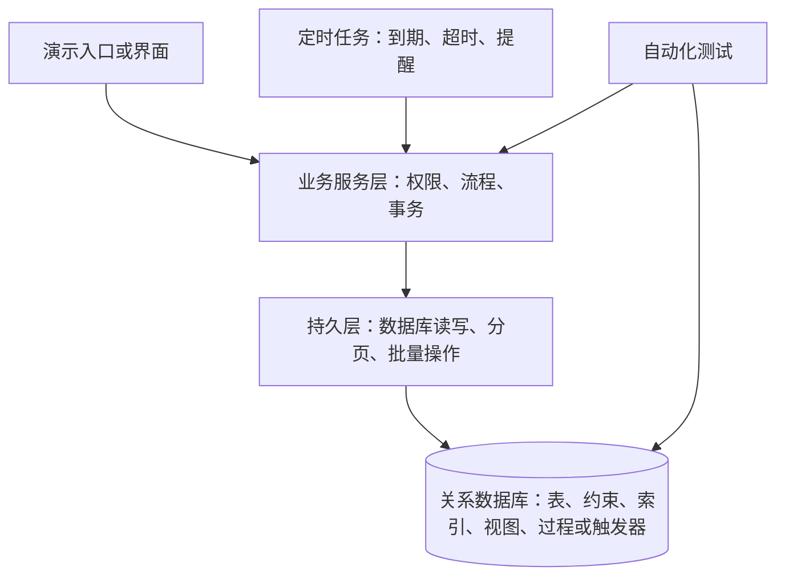

# 社区居家养老智慧服务平台需求与整体设计思路

日期：2026-11-12。版本：讨论稿 v0.1（保留初始分析）。

后续实施说明：用户已指定 Java，并提供更严格的小组及个人模板。现行实现与验收请以《需求追踪与模板差异》《数据字典与关系模式》《逻辑设计与范式分析》《运行维护与验收》及实际测试证据为准；下文中的“未实现”和候选结构描述属于初始规划阶段。

本项目围绕社区居家养老的建档、评估、服务、工时、补贴和监管过程，完成数据库设计、实现、测试与课程答辩。先确定业务规则和数据关系，再选择开发语言、数据库产品及演示方式。本文是仓库内的项目设计计划，不是已实现功能说明，也不代表小组已批准所有设计建议。

用户已明确：暂时不确定开发语言，先完成设计。当前不进入业务代码实现。

## 1 依据与要求的区分

来源 S1：[课程设计任务书](/Users/herbert/Library/Containers/com.tencent.xinWeChat/Data/Documents/xwechat_files/wxid_zcqy6xqd6p9q22_43fb/msg/file/2026-11/课设/社区居家养老智慧服务平台课程设计2026年任务书.pdf)，全文 9 页。

来源 S2：[老师讲解逐字稿](/Users/herbert/Library/Containers/com.tencent.xinWeChat/Data/Documents/xwechat_files/wxid_zcqy6xqd6p9q22_43fb/temp/drag/20261112144431-转写_数据库大课设——任务书解读-逐字稿文本-1.docx)，现有内容截至录音时间 00:34:23；老师在结尾表示会重新开会继续讲解，因此它不是全部课堂说明。转写存在错字，技术术语需结合语境理解。

- **硬性要求**：任务书明确要求，以及老师对其含义的明确补充。
- **设计建议**：为满足要求提出的结构、实现和测试方向，可以在后续讨论中调整。
- **待明确事项**：材料没有给出唯一答案，或仍有歧义的问题；不能默认为教师已经认可。

教师给出的表、视图和查询例子是设计起点。应覆盖全部五条业务线和五类角色，不以增加表数或重复查询凑数量。S2 的 08:47、27:30、31:06 对此有明确说明。

## 2 从哪里开始

第一项正式工作是完成需求分析：为每项核心业务写清“谁发起、需要什么数据、允许操作的条件、成功后改变什么、失败后怎样处理”。同时为规则编号并设计验证方法。

需求分析完成的判断标准：

1. 五条业务线都有正常流程与异常流程，五类角色都有明确的数据访问范围。
2. 关键规则能够找到对应的数据、操作入口和测试案例。
3. 区分已经确定的要求与尚未确定的业务口径。
4. 用同一个示例老人走通建档到补贴的流程，用异常案例说明系统怎样拒绝错误操作。

之后再绘制局部与全局 E-R 图，确定关系模式和数据字典。此阶段不先锁死表数，也不先按页面拼表。

## 3 项目范围与交付边界

必须覆盖：老人档案与评估、下单与派单、护工与排班、健康监测与应急、补贴与质量监管，以及登录权限、审计、备份恢复、持久层和测试。

建议采用一个应用、一个关系数据库，内部按业务模块组织。五个模块共享老人、社区、机构、护工、订单等标识；跨模块的数据变更通过明确的业务操作完成。

课程演示建议使用虚构老人、家属和健康数据，模拟设备上传、地理位置和拨付结果。演示仍应执行真实的数据库校验、事务和查询。真实硬件、政府接口、资金支付、短信服务及地图服务的接入不在当前拟定范围内；如教师另有要求再调整。

任务书明确要求持久层，没有明确规定必须做完整网页或移动端。后续可选择简单管理界面或其他可重复演示的操作入口；是否需要完整前端仍待确认。

## 4 角色与数据范围

| 角色 | 核心操作 | 建议的数据范围与限制 |
| --- | --- | --- |
| 社区服务管理员 | 建档、组织评估、维护计划、代下单、调度、处理投诉、汇总申报 | 管辖社区；迁移需有授权与历史记录，不能直接借迁移获取其他社区数据 |
| 老人及家属 | 查看档案、评估、计划、订单和费用，预约、确认、评价、反馈 | 本人或有效关联的老人；家属与老人的关联关系必须可验证 |
| 护工 | 接单、签到签退、记录服务、上报异常、查看工时 | 本人排班及被分配的订单；仅提供履职需要的老人信息 |
| 服务机构负责人 | 管理护工证书、排班、人员状态、投诉整改 | 本机构护工及相关服务；不能修改其他机构数据 |
| 街道与民政监管人员 | 分级审核、抽查、查看统计、跟踪整改 | 授权辖区；可以写入审核和监管结果，不能随意改写原始服务事实 |

五类角色是业务角色类别，不等于只能有五个账号，也不要求把所有监管岗位合成一个权限完全相同的角色。街道审核、民政审核可在权限层细分。账户、角色和辖区是三个不同概念。

老师明确要求家属只能看关联老人、护工只能看自己的订单，监管不能随意修改原始业务数据（S2 31:06）。隐藏页面按钮不能代替服务端授权检查。普通视图也不会自动识别最终用户，必须与数据库授权或可信身份上下文下的访问过滤配合。

## 5 业务流程与功能需求

### 5.1 主流程

图表示核心关联，并不要求只能在拨付后抽查。监管可针对符合抽查规则的订单或护工开展工作。

健康监测是关联老人档案的一条独立流程：设备绑定 → 数据采集 → 异常标记与确认 → 按规则产生告警事件 → 响应与处置 → 记录结果；未按等级要求及时响应则升级。异常体征并不一律等于已确认的紧急事件，应保留确认与误报处理。

### 5.2 五条业务线

| 编号 | 业务线 | 必须覆盖的功能与主要异常 |
| --- | --- | --- |
| F01 | 档案与评估 | 建档、监护关系和特殊标签维护、社区迁移、历次评估、计划及项目频次、复评提醒；阻止重复档案和重叠生效计划，评估过期后暂停相关业务 |
| F02 | 下单与派单 | 服务目录、预约、社区代下单、候选护工推荐、派单与改派、服务记录、确认和评价；超时未接单进入调度，保留改派原因 |
| F03 | 护工与排班 | 机构和护工档案、证书及适用项目、服务区域、人员状态、排班、接单名额、签到签退、工时复核和月度汇总；处理缺证、过期、冲突、满额和定位异常 |
| F04 | 监测与应急 | 设备及绑定历史、体征数据、阈值配置、待确认异常、事件分级、响应、通知记录、超时升级和处置结果；保留历史归属和升级轨迹 |
| F05 | 补贴与监管 | 政策有效期及适用条件、周期申报、订单明细和核算依据、街道与民政审核、拨付记录、抽查、投诉和整改；阻止重复申报和无凭据结算 |

补贴政策、能力等级与服务包的对应关系需要有来源。现阶段不填入未经核实的真实补贴金额、健康阈值或响应时限；可以先设计可配置结构，后续为模拟规则标明“课程演示假设”。

### 5.3 关键规则及验收方向

| 编号 | 规则及来源 | 设计与验证方向 |
| --- | --- | --- |
| R01 | 同一身份证不重复建档，迁移只变更归属。S1 2.1.1；S2 11:08 | 内部老人编号稳定；身份唯一性受约束；迁移前后档案和历史服务不丢失 |
| R02 | 评估过期暂停计划；老师补充不能继续下单和接单。S1 2.1.1；S2 15:07 | 定期处理到期状态，关键操作再次校验有效性；测试刚过截止时刻的请求 |
| R03 | 同一老人同一时段最多一份生效计划。S1 2.1.1 | 并发创建重叠计划时最多一个成功；仅对起止日期设唯一键不能保证不重叠 |
| R04 | 订单与派单一对多，改派保留原记录和原因。S1 2.1.2；S2 17:19 | 历史派单只终止其有效状态；建议同一订单同时最多一条有效派单 |
| R05 | 服务地址位于老人所属社区服务范围内。S1 2.1.2 | 下单和派单都校验；社区迁移后的未执行订单如何处理需明确 |
| R06 | 无老人或家属确认不能标为完成或进入补贴结算。S2 18:58 | 确认人须有相应关系与权限，记录确认时间和凭据；拒绝护工代确认 |
| R07 | 护工证书有效、服务项目与区域匹配，接单资格正常。S1 2.1.3、2.1.5 | 调度和接单重新校验；未来预约的证书判断日期需明确 |
| R08 | 已接单量不得超限；排班不得重叠。S1 2.1.3 | 名额变更与派单在同一事务；同时抢最后名额只能成功一次；实际服务预约也检查冲突 |
| R09 | 有效工时由签到签退和位置校验认定，异常转复核。S1 2.1.3 | 不直接把上报时长作为有效工时；保留原始打卡和复核结果，重复提交不能重复计时 |
| R10 | 同时一台设备只绑定一位老人，历史数据归原老人。S1 2.1.4 | 记录绑定区间，采集数据引用当时绑定；迟到上传按采集时间校验，不能按当前拥有者归属 |
| R11 | 按指标判断异常，按事件等级设响应时限并超时升级。S1 2.1.4 | 定时扫描与响应操作正确处理竞争；重复扫描不重复生成同一级升级和通知 |
| R12 | 同老人、同周期、同项目不得重复申报补贴。S1 2.1.5 | 约束不能仅包含政策编号而允许换政策重复申报；驳回、撤回后的重报语义需明确 |
| R13 | 申报金额可追溯到订单与实际工时。S1 2.1.5 | 申报主表关联明细，保存政策版本、核算依据；无确认或工时未通过不得纳入 |
| R14 | 整改未完成限制接单。S1 2.1.5 | 接单资格关联未关闭的整改限制；适用对象、恢复权限和条件需明确 |
| R15 | 原始服务、补贴和操作历史必须留痕。S2 06:51、18:58 | 限制业务账号直接修改、删除；修正采用追加记录和授权流程，并验证审计 |

R15 的目标是业务角色不能无痕改写事实，普通审计表本身并不构成对数据库超级管理员的绝对防篡改保证。报告应准确说明保护边界。

## 6 状态流转设计方向

状态表示业务目前走到哪一步。每次流转都应记录操作人、时间、原因和必要凭据，不能允许任意修改状态字符串。

| 对象 | 建议的主要状态及流转 |
| --- | --- |
| 照护计划 | 草稿 → 生效 → 暂停／到期／终止；复评通过后的恢复需再次检查时间重叠和服务资格 |
| 服务订单 | 待派单 → 待接单 → 待上门 → 服务中 → 待确认 → 已完成；取消、失败和退回调度另设受控分支 |
| 派单记录 | 待接单 → 已接单 → 服务结束；拒接、超时、改派结束保留为历史状态 |
| 工时 | 待核验 → 有效，或待人工复核 → 有效／无效；与订单是否已确认分别管理 |
| 补贴申报 | 草稿 → 已提交 → 街道审核通过 → 民政审核通过；驳回保留原因；拨付进度单独记录 |
| 应急事件 | 待响应 → 已响应 → 处置中 → 已关闭；升级级别和升级历史单独保留 |
| 整改 | 待整改 → 待复核 → 已关闭；复核不通过退回，限制接单状态据此判断 |

这些状态是设计建议。订单取消是否释放名额、服务中是否允许改派、复评如何影响旧计划等分支需要在正式需求分析中定稿。不能把“服务已结束”“订单已确认”“工时有效”“补贴已拨付”合并成一个状态。

## 7 数据模型的总体拆分

下表是候选实体组，不是最终建表清单。细化时逐一确定主键、外键、联系基数、函数依赖和第三范式；只有具有独立含义、生命周期或多值关系的数据才考虑拆分。

| 数据组 | 候选实体 | 拆分原因 |
| --- | --- | --- |
| 公共组织与身份 | 社区、服务机构、账户、角色与授权范围 | 各业务共享身份和辖区，避免每个模块重复维护 |
| 老人与照护 | 老人档案、家属关联、特殊标签关联、评估记录、服务包及项目、等级适用规则、照护计划及明细 | 保留多次评估；表达多个家属、标签和计划项目，不把列表塞进文本字段 |
| 服务与派单 | 服务项目、服务订单、派单记录、服务记录及确认、评价或投诉 | 区分预约、分配、实际服务与验收；支持改派留痕 |
| 人员与工时 | 护工、证书、证书与服务项目规则、护工服务区域与技能、排班、工时及复核记录 | 一人多证、多区域、多项目；原始打卡与核定工时含义不同 |
| 监测与响应 | 设备、设备绑定历史、体征记录、指标阈值、应急事件、响应与升级记录、通知记录 | 当前绑定不能替代历史归属；事件需要完整处理轨迹 |
| 补贴与监管 | 政策及适用项目规则、申报主表、申报明细、分级审核记录、拨付记录、质量抽查与整改 | 申报可以涉及多笔订单；核算依据、审核历史和拨付状态分别追溯 |
| 操作留痕 | 审计记录 | 记录关键操作对象、操作者、时间、原因和必要变化，避免记录密码等秘密 |

必须画清的关系包括：老人 1:N 评估、老人 1:N 计划、计划 1:N 计划明细、老人 1:N 订单、订单 1:N 派单、护工 1:N 证书与排班、设备 1:N 绑定历史、老人 1:N 绑定历史，以及申报通过明细关联多笔订单。

申报与订单的可重复关联范围要由 R12 的核算口径决定，不能仅凭“一个申报有多张订单”就允许同一订单多次获补。质量抽查可针对订单或护工；若采用两列可空外键，必须校验恰好一个目标，不使用无法校验归属的任意目标编号。

### 7.1 数据类型与历史口径

- 采用内部编号作为主键；身份证的业务唯一性单独保证，展示脱敏不等于数据库只存脱敏字符串。
- 身份信息的加密、可查重方式和密钥管理在安全设计中明确；不能依赖会发生碰撞的星号掩码查重，也不能把普通无密钥哈希宣称为匿名化。
- 金额采用定点数，避免浮点误差；服务时长采用统一单位，并说明舍入规则。
- 时间区间建议统一采用左闭右开，便于处理相邻班次。日期型有效期截止日的含义需另外定义，不能让当日零点意外提前失效。
- 不把项目清单、订单集合、多个标签或证书拼成逗号分隔字段；用明细表或关联表达关系。
- 历史订单应保留实际服务地址、当时价格和适用政策等核算依据，或引用不可变版本；不能用当前地址、价格和政策反算历史。
- 累计工时、评分、已接单量等能推导的值优先从明细计算；若缓存以满足性能或并发控制，需说明更新与核对机制。
- 需要先做规范化分析；价格等交易事实和受控历史快照与随意复制当前主数据有区别，不能以“留历史”为由复制所有字段。

## 8 系统分层与规则落点

| 机制 | 主要负责什么 |
| --- | --- |
| 主键、外键、唯一、非空与检查约束 | 防止重复标识、悬空引用、必填缺失、非法范围等基础错误 |
| 事务、锁或数据库提供的并发约束 | 保护名额、非重叠区间、申报资格等跨行规则；具体语法待数据库选型 |
| 业务服务层与受控数据库操作 | 校验操作权限、状态转换与多表业务条件，定义事务边界 |
| 视图与数据库授权 | 提供有明确用途的查询入口和数据最小化，配合实际角色及行范围控制 |
| 存储过程或触发器 | 承担适合数据库执行的校验或自动处理；每条业务线至少一个 |
| 定时任务 | 主动检查时间到期、订单超时、应急超时；时间流逝本身通常不触发普通 DML 触发器 |

尽量为同一规则指定一个主要实现位置，其他入口复用。涉及数据库完整性的关键规则不能只有网页检查；如果由受控过程实现，业务账户就不应还能绕过过程直接写基础表。

重点事务边界：创建或恢复计划；占用名额并建立派单；改派时结束旧分配并转移名额；提交含多笔订单的补贴申请；审核与金额状态变更。事务失败必须完整回滚。

并发方案在数据库选型后细化。一个可研究的方向是按老人、排班或申报资格锁定共同的控制对象，再检查并写入；只“先查询后插入”而没有并发保护不够。锁顺序、死锁重试和重复请求处理也要纳入设计。

## 9 数据库专项要求的预规划

### 9.1 十五个有不同用途的候选视图

| 业务线 | 视图一 | 视图二 | 视图三 |
| --- | --- | --- | --- |
| 档案与评估 | 复评到期工作清单 | 当前生效计划及项目频次 | 家属可查询的老人照护摘要 |
| 下单与派单 | 超时未接单调度清单 | 已服务待确认订单清单 | 订单改派历史与原因追踪 |
| 护工与排班 | 资质到期及项目资格清单 | 班次剩余名额与可用时段 | 工时异常及人工复核清单 |
| 监测与应急 | 设备当前绑定与设备状态 | 待确认的异常体征清单 | 未关闭事件及响应时限进度 |
| 补贴与监管 | 待申报订单及资格缺项 | 申报审核与拨付进度 | 未完成整改及接单限制 |

以上是候选业务含义，不表示已建立 SQL 视图。家属视图必须结合身份范围控制；不能因视图名称包含“家属”就认为已经隔离数据。时变查询和定时状态更新需明确各自语义。

### 9.2 五个候选存储过程或触发器

| 业务线 | 候选数据库例程 | 调用方式与重点 |
| --- | --- | --- |
| 档案与评估 | 处理评估到期并暂停计划的过程 | 定时调用，记录原因；关键操作即时检查不依赖任务准时运行 |
| 下单与派单 | 改派过程 | 结束旧派单、记录原因、校验新人选并转移名额；统一事务边界 |
| 护工与排班 | 核验工时过程 | 校验打卡时间、位置结果和派单归属；异常进入复核，重复执行不重复累计 |
| 监测与应急 | 应急超时升级过程 | 定时调用，依据等级规则升级，避免与已响应操作冲突或重复升级 |
| 补贴与监管 | 提交补贴申报过程 | 校验全部明细、重复申报和核算依据；任一明细失败整体回滚 |

课程允许每条业务线在存储过程与触发器中选择，并非必须各写一个。以上先以过程描述；选型后根据数据变更触发需求决定是否改用或补充触发器，不在程序和数据库重复实现同一套逻辑。

### 9.3 五条复杂查询的候选场景

| 查询 | 场景 | 至少关联的数据 |
| --- | --- | --- |
| Q01 | 某社区重度失能且有有效计划的老人和责任护工 | 老人、社区、有效评估、计划、护工 |
| Q02 | 按机构统计护工月度有效工时、完成率和投诉情况 | 机构、护工、派单、订单、工时、投诉 |
| Q03 | 为待派订单筛选具备资质、区域覆盖和可用排班的护工 | 订单、项目、护工、证书、区域、排班 |
| Q04 | 按社区和事件等级统计应急响应及时率 | 老人、事件、响应记录、等级时限规则、社区 |
| Q05 | 追溯某周期补贴申请的政策、订单、确认和有效工时 | 申报、明细、政策、订单、服务确认、工时 |

这些查询分别覆盖条件筛选、多表连接和聚合。需要定义统计口径，例如完成率用哪一批订单作分母、取消订单是否纳入、投诉按条数还是不同订单数、无响应事件如何计算超时。不得把多个一对多明细直接连接后重复累加工时或金额，应先按所需粒度汇总或正确去重。

为查询保存预期结果、执行计划及优化前后证据。每表 20 条是最低数量；性能分析可另备较大规模的虚构业务数据，不能用很小的数据集宣称优化效果显著。

## 10 测试与保护机制

测试包含正常、边界、拒绝、回滚、并发和越权场景。测试应连接真实选定的数据库来验证约束和事务，仅模拟数据库返回结果不足以证明这些要求。

| 类别 | 必须准备的代表案例 |
| --- | --- |
| 档案与历史 | 身份重复拒绝；跨社区迁移仍是同一档案；旧订单归属口径不被无意改写 |
| 时间边界 | 评估或证书刚过期；相邻不重叠班次；真正重叠的班次或计划被拒绝 |
| 派单与容量 | 改派保留旧记录；并发抢最后一个名额；新人选不合格时旧分配不能丢失 |
| 确认与工时 | 无确认不得完成；无权家属不能确认；错误位置转复核；重复签退不重复计时 |
| 监测与应急 | 设备换绑后的迟到数据仍归原老人；重复扫描只升级一次；响应与升级竞争 |
| 补贴事务 | 多订单中一笔不合格则全体回滚；并发重复申报拒绝；审核状态不能越级跳转 |
| 权限 | 家属不能读取他人老人；护工不能读取他人订单；监管不能改原始服务工时 |
| 备份恢复 | 在独立测试库恢复备份，核验记录、约束、例程、权限与关键查询 |

安全设计需覆盖加盐密码哈希、失败次数限制、会话超时、参数化查询、角色和辖区校验、敏感字段加密与展示脱敏、最小数据库权限。具体算法、工具和配置待技术选型后确定。

备份方案必须说明全量与增量周期、可接受数据丢失时间（RPO）、恢复时间目标（RTO）和恢复演练步骤。不能只写“每天备份”，也不能没有演练就声称可恢复。具体周期与目标作为课程演示约定，在选型后定稿。

## 11 分阶段实施与团队协作

| 阶段 | 主要产物 | 进入下一阶段前要确认 |
| --- | --- | --- |
| 1 需求定稿 | 用例、规则清单、权限矩阵、状态流转、待明确事项 | 全业务线覆盖，关键规则都有验收案例 |
| 2 概念设计 | 五个局部模型与全局 E-R 图 | 共用实体一致，多对多、历史关系和联系基数正确 |
| 3 逻辑与物理设计 | 关系模式、函数依赖、第三范式分析、数据字典、索引与约束方案 | 完成数据库选型，关键并发和时效规则有可实施方案 |
| 4 数据库实现 | DDL、测试数据、视图、例程、五条查询 | 空库可重建，基础校验和查询结果正确 |
| 5 持久层与流程实现 | CRUD、分页、批量操作、事务、授权、定时任务、演示入口 | 正常流程贯通，异常操作可拒绝并留痕 |
| 6 测试与优化 | 并发和回滚测试、越权测试、执行计划、恢复演练 | 每项硬性要求有可复核证据 |
| 7 整理与答辩 | 小组材料、个人材料、PPT、全员参与录像、贡献记录 | 按提交清单核查，组员能解释本人负责内容 |

任务书给出的建议有效周期为一周，不是已知的具体截止日期。语言、数据库、成员和实际截止日期尚未确定，此处不编造日历排期。

分工建议以业务线为主要责任单元，每个人覆盖自己模块的需求、模型、SQL、测试和讲解；另指定公共模型、集成、文档核对的责任人。四人组可调整模块组合，但需按实际工作量平衡，不必机械一人一条线。不要把一个人固定成只写文档、不了解数据库的人。

各模块先统一主键命名、时间与金额口径、状态值、外键关系和公共实体，再分别实现。Git 提交、会议记录和个人贡献应随开发产生；本次仅建立设计文件，尚未初始化版本库或创建远程仓库。

## 12 硬性要求与验收证据清单

| 要求 | 需要保留的证据 |
| --- | --- |
| 全业务用例分析和数据字典 | 用例与规则对照、实体字段定义及约束范围 |
| 局部与全局 E-R 图或 UML 类图 | 可读图件、关系基数与类型标注 |
| 逻辑结构符合第三范式 | 关系模式、主外键、函数依赖与分析说明 |
| 物理结构与可执行 DDL | 字段、长度精度、约束、默认值、索引；空库执行日志 |
| 每张表至少 20 条测试数据 | 各表行数报告、合理关联与边界数据 |
| 5 条各关联至少 3 个关系的 SQL | 查询文件、预期及实际结果、执行计划与优化说明 |
| 持久层与核心操作测试 | CRUD、分页、批量操作代码，以及事务、并发测试结果 |
| 每业务线至少 3 个实用视图 | 至少 15 个视图，用途与角色说明、查询及权限验证 |
| 每业务线 1 个过程或触发器 | 至少 5 个，触发或调用方式、输入输出与验证结果 |
| 安全、备份恢复、脱敏加密 | 策略说明、关键拒绝案例、恢复演练证据 |
| 团队过程与提交物 | 4—5 人分工、版本和会议记录、小组包、个人 PDF |
| 答辩 | PPT、5 分钟且所有组员发言的录像、个人技术说明 |

当前上述实现和验收均未完成；本文只完成需求与设计方向的预梳理。

## 13 需要在设计定稿前明确的问题

1. **每表 20 条与小型字典冲突**：角色、状态、等级等可能天然不足 20 种，不能为凑数编造无意义类别。向老师确认此类表是否有例外；确认前保留任务书原要求，不自行豁免。
2. **未来预约的有效性**：评估和证书按下单时、预约服务时还是两者都校验？建议至少在派单、接单及服务开始等关键节点重新校验，最终条件需写入需求。
3. **正在进行的服务**：评估到期后的“停止下单和接单”不能直接推导为终止正在进行的服务；存量订单和紧急事件如何处理需单独定义。
4. **确认凭据**：老人本人、家属和双方签字各如何记录，是否存在代理确认例外？先遵守“必须有老人或家属确认”的明确口径。
5. **补贴周期与重报**：周期按服务发生还是申报日期？不同政策周期如何对齐？驳回或撤回后如何重报而不重复获补？一条申报是否只对应一位老人、一项政策、一个周期？
6. **实际政策和阈值**：选择哪个地区的补贴政策；评估等级如何对应服务包；异常指标和事件响应规则采用什么来源？真实来源与演示假设必须区分。
7. **容量与时间**：排班名额按班次订单数还是其他方式消耗；改派、取消、拒接何时释放；实际预约时长如何防止冲突？
8. **迁移、整改和监管范围**：迁移后待执行订单如何处置、整改限制哪些项目、谁有权解除限制、跨社区历史数据由谁查看？
9. **课程组织信息**：小组成员与人数、其余课堂说明、个人报告模板、实际截止日期、是否需要完整界面尚未提供。

以上问题不妨碍先画业务流程和候选实体关系，但会影响最终约束、数据模型或验收口径。下一步应围绕这些问题完善正式用例和全局 E-R 草图，而不是立即生成大量业务代码。
