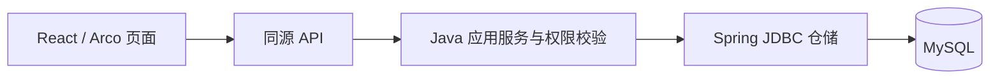

# 左邻右舍前端

React 18、TypeScript、Arco Design React 和 Vite。表格、表单、抽屉、日期选择、弹窗、消息提示、导航和分页使用 Arco 组件，蓝色主题及页面布局在 `src/styles` 中定义。登录页保留社区建筑插画，工作台支持桌面表格和手机记录卡片。

前端通过同源 `/api` 调用 Java 服务；权限、事务、数据库约束和 JDBC 查询由服务端执行。浏览器不接触数据库密码和字段加密密钥。页面权限用于呈现可办理动作，不能替代服务端鉴权。

## 开发与构建

安装 Node.js 22.12 及以上和 npm。在仓库根目录执行：

```sh
npm --prefix frontend ci
npm --prefix frontend run dev
```

访问 `http://127.0.0.1:18089`。开发服务器默认代理到 `http://127.0.0.1:18080`；设置 `FRONTEND_API_TARGET` 可连接独立测试应用。代理包含 API、图片和人物资料，不需要为开发修改后端 CORS。

```sh
npm --prefix frontend run check
npm --prefix frontend test
npm --prefix frontend run format:check
mvn -DskipTests clean package
```

Maven 自动执行 `npm ci` 和生产构建，将 `frontend/dist` 放入 JAR 的静态资源目录。运行编译好的 JAR 只需 Java 和 MySQL，无需 Node.js、npm 或单独启动前端服务。依赖通过 `package-lock.json` 固定，`node_modules` 和 `dist` 不入库。`package.json` 中 React、Arco 与构建工具均锁定具体版本；从仓库安装使用 `npm ci`，新增依赖才使用 `npm install <包名> --save-exact` 并同步锁文件。

## 目录与职责

| 目录 | 职责 |
| --- | --- |
| `src/api` | 请求、会话、统一错误和分页查询 |
| `src/model` | 角色菜单、字段定义、状态动作、中文显示和详情阶段 |
| `src/forms` | 字段控件、联动查询、条件校验、草稿及提交 |
| `src/pages` | 登录、角色工作台和列表布局 |
| `src/components` | 详情、密码维护、照片与头像 |
| `src/hooks` | 可取消的异步加载和响应式布局 |
| `tests` | 角色动作、依赖清空、字段和提交规则测试 |

`registry.json` 保存查询名称、角色菜单和 73 种业务操作的字段元数据。修改 API 或业务规则时，需要同步元数据、`rules.ts`、`schema.ts` 及相应测试。SQL 投影的动态行结构在 `model/types.ts` 中统一表示，组件在对应字段处解释值。

## 浏览器验证

脚本位于仓库的 `scripts/react`。`npm ci` 安装锁定版本的 Playwright；浏览器测试还需要本机 Chrome，以及已初始化并导入课程业务状态示例的独立 MySQL 测试应用。必须显式设置 `TEST_DATABASE=eldercare_<名称>_test`；`TEST_PORT` 默认为 18087，可取 18081—18089。密码从环境变量 `DEMO_PASSWORD` 或本机 `.local/config.json` 获取。

```sh
TEST_DATABASE=eldercare_example_test TEST_PORT=18087 node scripts/react/verify_pages.cjs
TEST_DATABASE=eldercare_example_test TEST_PORT=18087 node scripts/react/verify_workflows.cjs
TEST_DATABASE=eldercare_example_test TEST_PORT=18087 node scripts/react/verify_records.cjs
TEST_DATABASE=eldercare_example_test TEST_PORT=18087 node scripts/react/verify_passwords.cjs
TEST_DATABASE=eldercare_example_test TEST_PORT=18087 node scripts/react/verify_forms.cjs
TEST_DATABASE=eldercare_example_test TEST_PORT=18087 node scripts/react/verify_media.cjs
TEST_DATABASE=eldercare_example_test TEST_PORT=18087 node scripts/react/verify_claims.cjs
```

工作流、档案和密码脚本会写入虚构数据；不得连接展示库运行。页面检查覆盖全部角色入口，表单检查涵盖前置依赖、失败重试、草稿和条件字段。真实业务约束仍由 Java/MySQL 回归验证。结果保存在 `evidence/react`，可通过 `EVIDENCE_DIR` 指定其他目录。

`node scripts/react/run.cjs` 按顺序执行整组浏览器检查。场景枚举检查应在业务写入前执行；整组测试使用新建的测试库，避免重复审核已处理的种子业务。根目录下同名 `scripts/verify_*.cjs` 入口调用对应的 React 检查。

## 页面与数据链路



社区、机构、服务和政策名称由 API 返回，前端不维护一套替代业务数据库的假数据。初始化资料与已有库的名称升级脚本分别位于 `src/main/resources/seed-labels.json` 和 `database/migrations/20261116_seed_names.sql`。头像按人物编号和姓名匹配；未配置照片的记录显示姓名首字。工作台“关于平台”说明资料和照片来源，模拟采样仍保留来源标识。

Windows PowerShell 的前端命令与上文相同。配置独立浏览器测试时使用 PowerShell 环境变量语法，例如：

```powershell
$env:TEST_DATABASE = 'eldercare_example_test'
$env:TEST_PORT = '18087'
node scripts/react/verify_pages.cjs
```

这些命令需要先启动连接该测试库的 Java 应用；端口和库名不能只填写变量而不核实实际连接。Windows 实机验收仍需在目标电脑完成。
